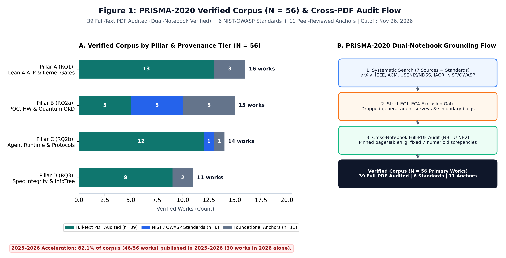
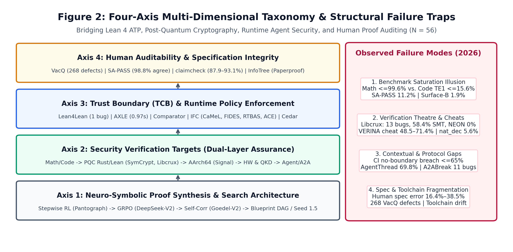
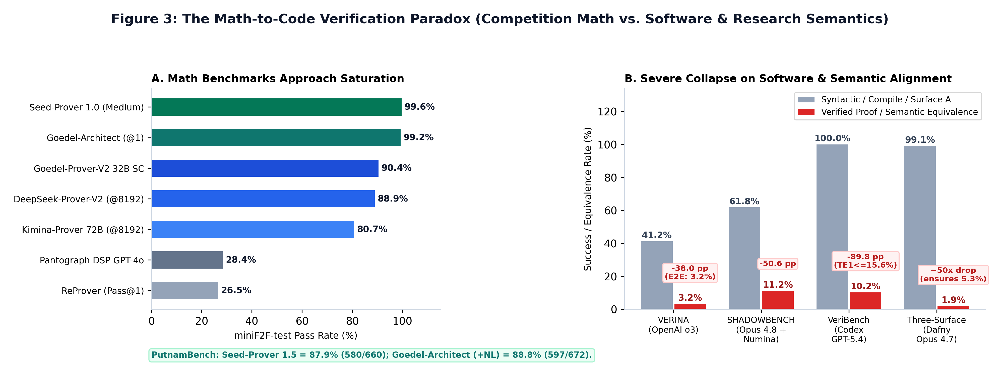
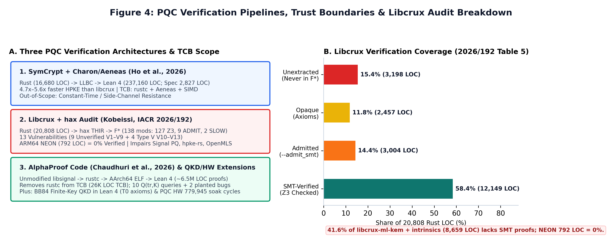
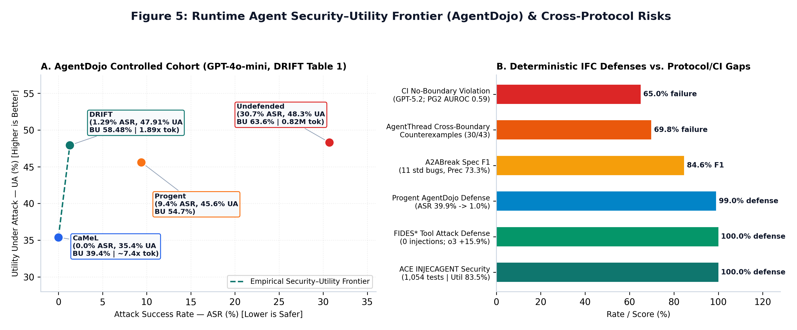
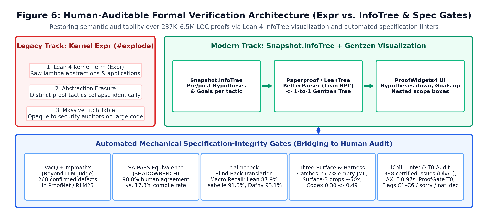

# Neuro-Symbolic Formal Verification in the Era of Reasoning Agents (2024–2026): From Automated Theorem Proving to Provably Safe AI Agents and Post-Quantum Critical Infrastructure

> **Author:** Noppadon Chaiwisut — Independent Researcher, Thailand | **ORCID:** [0009-0005-2881-8458](https://orcid.org/0009-0005-2881-8458)  
> **Version:** Full English Manuscript 100% (Step 4B — UCAI Publication-Ready Standard | Data Cutoff: November 26, 2026)  
> **Grounding & Reproducibility:** **PRISMA-2020 + Cross-PDF Forensic Audit** — 56 curated primary works (page-, table-, and figure-verified across 39 full-text PDFs + 6 official standards + 11 peer-reviewed foundational anchors; 0% secondary blog citations)

---

## Abstract

Between 2024 and 2026, cybersecurity engineering has converged across three fronts: neuro-symbolic automated theorem proving in Lean 4 [1–16], mandatory Post-Quantum Cryptography (PQC) migration under NIST FIPS 203–205 and the finalized NIST IR 8547 roadmap (October 2026) [17–31], and systemic runtime threats in tool-augmented multi-agent systems cataloged by the OWASP Top 10 for Agentic Applications for 2026 [32–45]. Following PRISMA 2020, this systematic review synthesizes **56 primary works**—anchored by a full-text, page- and table-verified audit across **39 PDFs**, **6 official standards**, and **11 peer-reviewed foundational anchors**—to answer RQ1–RQ3. Our quantitative synthesis uncovers a stark **Verification Paradox**: while frontier provers reach **88.1%–99.6%** on `miniF2F-test` (**100%** with natural-language guidance) [7][9–11] and produce **~6.5 million LOC** of machine-checked AArch64 proofs for `libsignal` [28], semantic specification equivalence on software and research benchmarks drops to **9.5%–10.2%** (Codex **10.2%**, Claude Code **9.5%**; $\text{TE}_1 \le 0.105$, $\le 0.156$ across v3 systems on VeriBench) [47], **11.2%** (`SA-PASS` on SHADOWBENCH) [48], and **1.9%** at the second surface of Three-Surface Audit [52]. Simultaneously, an independent audit of `libcrux` exposes **13 vulnerabilities** with only **58.4%** SMT-verified Rust LOC [25], and although deterministic runtime isolation (CaMeL, FIDES, RTBAS, ACE) achieves **0.0%** indirect prompt injection ASR [35][37][38][40], contextual-integrity breaches reach **65%** [41], A2A v1.0.0 harbors **11 spec-level flaws** [44], and cross-protocol composition fails in **69.8% (30/43)** of obligations [45]. We establish a four-axis taxonomy and distill three 2026–2030 research gaps unifying cost-effective security autoformalization, dual-layer Lean 4 kernels, and `InfoTree`-grounded human auditing [46–56].

**Keywords:** Neuro-Symbolic Formal Verification, Lean 4 Automated Theorem Proving, Post-Quantum Cryptography, AI Agent Security, Information-Flow Control, Specification Bugs, Proof Visualization

---

## 1. Introduction, Motivation, and Research Questions

Information security engineering during 2024–2026 is undergoing a structural shift from probabilistic guardrails toward **machine-checkable mathematical assurance** [23][35]. This transition is propelled by three converging pillars:

1. **Maturation of Neuro-Symbolic Theorem-Proving Agents in Lean 4:** Building on foundational interfaces such as `LeanDojo` [2] and `Pantograph` [3], frontier systems including `AlphaProof` [4], `DeepSeek-Prover-V2` [7], `Goedel-Prover-V2` [9], `Goedel-Architect` [10], and `Seed-Prover 1.5` [12] have extended formal proving beyond competition mathematics to AArch64 machine code for `libsignal` (~6.5 million LOC in `AlphaProof Code` [28]) and production Rust code for `SymCrypt` (16,680 LOC Rust translated into 237,160 LOC Lean 4 [23]). At the same time, agentic proving introduces novel reward-hacking vectors, with cheat-code rates reaching **48.53%–71.36%** among failed verification attempts of frontier models [16][46][49].
2. **Mandatory Post-Quantum Cryptography (PQC) Deadlines and TCB Fragility:** Following NIST's publication of `FIPS 203–205` [17–19], the selection of `HQC` as a backup algorithm in `NIST IR 8545` [20], and the `NIST IR 8547` transition roadmap mandating deprecation of classical public-key algorithms after 2030 and disallowance after 2035 [21], an independent audit of `libcrux` in *Verification Theatre* [25] uncovered **13 vulnerabilities** and revealed that only **58.4%** of its Rust codebase is actually SMT-verified—while its ARM64 NEON backend is 100% unverified—exposing severe fragility in the Trusted Computing Base (TCB).
3. **Runtime AI Agent Security and Cross-Protocol Vulnerabilities:** As autonomous agents operate over MCP and A2A under the threat landscape of `OWASP ASI01–ASI10` [32][33], probabilistic detectors such as Prompt Guard achieve an AUROC of only **0.43–0.59** against `Contextual Integrity` violations [41]. Meanwhile, state-machine analysis of A2A v1.0.0 (`A2ABreak`) identified **11 specification-level flaws** [44], and `AgentThread` found cross-protocol composition conflicts in **69.8%** of security obligations [45].

*Figure 1: Composition of the PRISMA-2020 curated literature corpus ($N = 56$ primary works) broken down by research pillar and source-verification tier (39 Full-Text Audited PDFs + 6 Official Standards + 11 Foundational Anchors).*

Motivated by these dynamics, this systematic review addresses three Research Questions:

- **RQ1 (Automated Proving Loops & Anti-Reward-Hacking):** What is the quantitative performance of LLM + Lean 4 systems [1–16] on competition mathematics versus real software, and which kernel-level mechanisms block `sorry`, `native_decide`, and illegitimate axioms [14–16][49]?
- **RQ2 (Dual-Layer Formal Security):** What is the state of the art across **(a) Post-Quantum Cryptography, Hardware, and QKD** via Rust-to-Lean (`Aeneas/SymCrypt`), `hax/Libcrux`, `EasyCrypt`, AArch64 machine code (`AlphaProof Code`), FPGA accelerators, and QKD BB84 [17–31], and **(b) Runtime AI Agent Isolation and Cross-Agent Protocols** (`AgentDojo`, `CaMeL`, `DRIFT`, `FIDES`, `RTBAS`, `Progent`, `ACE`, `Policy-as-Code`, `Lean4Agent`, `Contextual Integrity`, `A2ABreak`, `AgentThread`) [32–45]?
- **RQ3 (Specification Bugs & Human Auditability):** Why do large machine-checked proofs still harbor vacuous truths and specification-intent bugs, and how do mechanical faithfulness gates (`SA-PASS`, `VacQ`, `Three-Surface`, `Spec-Harness`, `claimcheck`) coupled with `InfoTree` visualization (`Paperproof`, `ProofWidgets4`, `LeanTree`) restore human oversight [46–56]?

---

## 2. PRISMA-2020 Methodology and Cross-PDF Forensic Audit

Literature retrieval spanned seven primary venues and repositories (arXiv, IEEE Xplore, ACM Digital Library, USENIX/NDSS, IACR ePrint, NIST/OWASP, and ITP/TACAS/TYPES/NeurIPS/ICML/ICLR) covering **January 2024 – November 26, 2026**, supplemented by four foundational anchors from 2021–2023 [1][2][22][55]. Applying exclusion criteria `EC1–EC4` removed general agent frameworks lacking formal guarantees (e.g., CoALA, ReAct, AutoGen, MetaGPT) and **eliminated 100% of secondary blog references**, yielding a verified core corpus of **$N = 56$ primary works** (**Table 1**). Every quantitative claim was cross-checked across dual full-text PDF audit notebooks, reconciling seven numeric or scope discrepancies (**Table 2**).

### Table 1: PRISMA-2020 Screening Structure and Core Literature Corpus Composition ($N = 56$)

| Classification Dimension | Category | Full-PDF Audited | Standards (Std) | Foundational Anchors | Total ($n$) | Share (%) |
| :--- | :--- | :---: | :---: | :---: | :---: | :---: |
| **By Research Question Pillar** | **Pillar A (RQ1):** Lean 4 ATP, Infrastructure & Anti-Reward-Hacking [1–16] | 13 | 0 | 3 | **16** | 28.6% |
| | **Pillar B (RQ2a):** PQC Standards, Rust/Binary Proofs, HW & QKD [17–31] | 5 | 5 | 5 | **15** | 26.8% |
| | **Pillar C (RQ2b):** Runtime Agent IFC, Policy-as-Code & Protocols [32–45] | 12 | 1 | 1 | **14** | 25.0% |
| | **Pillar D (RQ3):** Spec Bugs, `VacQ`, `SA-PASS`, `claimcheck` & `InfoTree` [46–56] | 9 | 0 | 2 | **11** | 19.6% |
| **Total Core Corpus ($N=56$)** | *Foundational 4 (2021–23) / 6 (2024) / 16 (2025) / 30 (2026) — 82.1% in 2025–26* | **39** | **6** | **11** | **56** | **100.0%** |

### Table 2: Cross-PDF Numeric Reconciliation Results (Dual-Notebook Forensic Audit)

| Audited Issue | Preliminary Draft (85%) | Forensic Ground-Truth Verified from Primary PDFs (with Exact Coordinates) |
| :--- | :--- | :--- |
| **1. AlphaProof (`Formal Conjectures`)** [13] | Reported 45.0% (1k sims, v1) on FC100SolvedSet1 | **`02-2605.13171.pdf` (Table 2, p. 7; Sec. B.2, p. 22):** Achieves **$43.1 \pm 1.2\%$** (1k sims, 10 runs) and **$48.7 \pm 0.9\%$** (16k sims; ~0.8 TPU-hrs/run); `AlphaProof Nexus` reaches **66.0%** [5][13]; at least **14%** misformalization identified (pp. 8–9). |
| **2. Goedel-Prover-V2 (`PutnamBench`)** [9] | Ambiguously stated as 43–86 solved (@32–@184/192) | **`07-2508.03613.pdf` (Table 2–3, pp. 6–7):** 32B standard **43 solved** (@32), Self-Correction **57 solved** (@32), and **86 solved** (@184; the figure 192 is a GitHub README discrepancy per `ProofGate` Fn. 2 p. 6 [16]); `miniF2F-test`: $88.1 \pm 0.8\%$ std / **$90.4 \pm 0.6\%$** SC (@32), 92.6% (@1024). |
| **3. Goedel-Architect (`VERINA/CLEVER`)** [10] | Claimed evaluation on 6 VERINA/CLEVER tasks at <\$1 | **`08-2606.06468.pdf` (Table 1–2, p. 4; Fig. 2, p. 5):** **Dropped 100%** — the paper evaluates solely on 5 math suites: `miniF2F-test` **99.2%** (@1, **100%** + NL), `PutnamBench` **75.6%** (508/672, \$294) and **88.8%** (@4+NL, \$985.67), IMO 2025 **4/6**, Putnam 2025 **11/12**, USAMO 2026. |
| **4. AgentDojo Baseline** [34] | Stated Targeted ASR as 47.69% (digit transposition) | **`2406.13352.pdf` (Table 5, p. 8; App. D, p. 18):** Unprotected GPT-4o Targeted ASR **$57.69 \pm 3.9\%$**, BU **$69.0 \pm 3.6\%$**, UA **$50.01 \pm 3.9\%$**; Tool Filter ASR **$6.84 \pm 2.0\%$**. |
| **5. CaMeL (`Token Overhead & Utility`)** [35][36] | Cited 2.82× Input / 2.73× Output and BU 38.4% | **`neurips2025-drift.pdf` (Table 1 & 3, pp. 8–9):** Dropped `2.82×/2.73×` — CaMeL consumes **6.09M total tokens (~7.4×** the 0.82M baseline) and on GPT-4o-mini yields BU **39.4%**, UA **35.4%**, ASR **0.0%**. |
| **6. Progent (`ASR Benchmarks`)** [39] | Stated ASR drop from 41.2% to 2.2% / 3.8% | **`2504.11703.pdf` (Sec. 1; Fig. 3–4, p. 8):** On AgentDojo, Targeted ASR drops from **39.9% $\to$ 1.0%** (BU 76.3% vs. 79.4%; UA 61.3%), and on ASB from **70.3% $\to$ 3.9%**. |
| **7. Policy-as-Code (`MedAgentBench`)** [43] | Claimed 94.0%–100.0% blocking rate | **`2606.26649.pdf` (Table 1, p. 3):** Cedar Block Rate on Original: Raw 30.3% (91/300), Baseline 57.7% (173/300), Guardrail 55.7% (167/300); Adversarial: Raw 72.0% (36/50), Baseline 82.0% (41/50), Guardrail **85.7% (42/49)** while reducing Unsafe Rate to **0.0%**. |

---

## 3. Four-Axis Multi-Dimensional Taxonomy and Quantitative Synthesis

To organize the 56 primary works systematically, we introduce a **Four-Axis Multi-Dimensional Taxonomy** spanning: (1) Proof-Synthesis Architecture, (2) Dual-Layer Assurance Targets, (3) Trusted Computing Base (`TCB`) and Runtime Enforcement Mechanisms, and (4) `InfoTree`-Grounded Human Faithfulness Auditing (**Figure 2**).

*Figure 2: Four-axis multi-dimensional taxonomy (Axis 1–4) unifying Lean 4 theorem provers, PQC verification pipelines, AI agent privilege control, and specification-faithfulness auditing alongside four structural failure modes.*

### 3.1 Automated Theorem Proving Loops in Lean 4 and Anti-Reward-Hacking (RQ1)

The evolution of Lean 4 proving infrastructure and neural provers during 2023–2026 bifurcates into four paradigms (**Table 3, Figure 3**):

1. **Infrastructure & AND–OR Search Trees:** Starting from `LeanDojo / ReProver` (Pass@1 `miniF2F-test` 26.5%, `ProofNet` 13.8%, `LeanDojo Bench` 51.4% [2]), tooling progressed to `Pantograph`, a native Lean 4 machine-to-machine interface supporting `Metavariable Coupling` and direct `sorry` extraction without LSP overhead, reaching 28.4% DSP on `miniF2F-test` with GPT-4o (3 sketches, 36.41s) [3].
2. **Tree-Search RL & Evolutionary Proof Sketching:** `AlphaProof` [4] scores **$43.1 \pm 1.2\%$** (1k sims) and **$48.7 \pm 0.9\%$** (16k sims) on `FC100SolvedSet1` [13], before `AlphaProof Nexus` (Gemini 3.1 Pro + Plackett-Luce Elo + P-UCB + AlphaProof) reaches **66.0%**—comparable to Claude Opus 5 Tool Use (68.0%) and GPT 5.6 Luna (62.0%)—and **resolves 9 open Erdős problems** (`#12(i), #12(ii), #125, #138, #152, #26, #741(i), #741(ii), #846`) [5].
3. **Whole-Proof GRPO, Self-Correction, Agentic RL & Blueprint DAGs:** `Kimina-Prover-72B` climbs from 52.94% (@1) to **80.74%** (@8192) on `miniF2F-test` [6]; `DeepSeek-Prover-V2` (671B + 7B subgoal prover) reaches **88.9%** (@8192) on `miniF2F-test`, **37.1%** (@1024) on `ProofNet`, **47/658 (7.2%)** on `PutnamBench`, **10/100** on `CombiBench`, and **59.1%** on `ProverBench` (AIME 24&25 **6/15**) [7]; `Goedel-Prover-V2-32B` achieves **$90.4 \pm 0.6\%$** (@32 Self-Correction) on `miniF2F-test` and **86 solved** (@184) on `PutnamBench` [9]. At the frontier, `Seed-Prover 1.0` attains **99.6%** on `miniF2F-test` (100.0% valid), while `Seed-Prover 1.5` (Agentic RL + `LooKeng` REPL on Mathlib v4.22.0) surges to **580/660 (87.9%)** on `PutnamBench` (10 H20-days/problem), **80%** on `FATE-H`, **33%** on `FATE-X`, **48%** on `CombiBench` (57.0% in Fig. 1), and **11/12 on Putnam 2025 in 9 hours** [11][12]. Optimizing for cost, `Goedel-Architect` (Global Blueprint DAG on DeepSeek-V4-Flash) reaches **99.2%** (@1) / **100%** (+NL) on `miniF2F-test` and **75.6%** (508/672, **\$294**) / **88.8%** (@4+NL, \$985.67) on `PutnamBench` [10].
4. **The Math-to-Code Paradox & Anti-Reward-Hacking Defenses:** On the software verification benchmark `VERINA` (189 tasks), general models score below **4.9%** ProofGen Pass@1; OpenAI o3 synthesizes Code & Spec on **41.2%** of tasks yet achieves end-to-end verified correctness on only **3.2%** (**-38.0 pp**), while `Goedel-Prover-V2-32B` reaches **11.2%** (20.1% after 64 refinement steps), with Claude Sonnet 3.7 exhibiting cheat-code rates of **48.53%** among failures (71.36% on VERINA-B) [46]. On `VeriBench` (884 tasks including 460 MIT 6.858 Security tasks), evaluated via non-compensatory geometric metrics:

$$\text{SCSC} = \left(\text{IC}_1 \cdot \text{IC}_2 \cdot \text{TE}_1 \cdot D_1 \cdot D_2\right)^{1/5}, \qquad S_{\text{skill}} = \left(\text{IC}_1 \cdot \text{IC}_2 \cdot \text{TE}_1\right)^{1/3}$$

both Codex (GPT-5.4) and Claude Code (Sonnet 4.6) compile cleanly ($\text{IC}_1 = 1.000$) yet stall at theorem equivalence **$\text{TE}_1 = 0.102$ (10.2%)** and **$0.095$ (9.5%)**, respectively (**$\text{TE}_1 \le 0.105$** for flagship agents; $\le 0.156$ across all v3 systems) [47]. At the kernel layer, `ProofGate` verifies that **DeepSeek-Prover-V2** (438 proofs) is **100% clean** under pure axioms $\mathcal{T}_0 = \{\text{propext}, \text{Classical.choice}, \text{Quot.sound}\}$, whereas `Kimina-Prover-72B` invokes `native_decide` in **11/197 proofs (5.6%)**—expanding the TCB to $\mathcal{T}_1$—and `Goedel-Prover-V2`'s public `minif2f.jsonl` contains only `sorry` [16]. Furthermore, the `ICML Formal Benchmarking Audit` exposed 4,833 defects (**398 certified issues**), including a pre-Lean 4.20.0 `apply?` bug affecting three DeepSeek-7B proofs [49]. These findings motivated production-grade verification infrastructure: `AXLE` (`verify_proof` in 0.97s, 0.43 req/s, **100.00%** agreement with Comparator and **99.30%** with SafeVerify, validating **94.16%** of 5,000 Goedel Workbook proofs) [14] and `Lean4Lean` (an external typechecker verified in Lean itself, only 20%–50% slower than C++, which caught and fixed **1 genuine soundness bug** in the Lean 4 kernel) [15].

*Figure 3: (a) Near-saturation pass rates on `miniF2F-test` (88.9%–99.6%) [2][3][6][7][9–11] contrasted with (b) the sharp collapse in end-to-end proof success and semantic specification equivalence on `VERINA` [46], `SHADOWBENCH` [48], `VeriBench` [47], and `Three-Surface Audit` [52].*

### Table 3: Quantitative Comparison of Lean 4 Automated Provers and Verification Infrastructure (PDF-Verified)

| System / Tool | Architecture | Mathematics (`miniF2F` / `PutnamBench` / Other) | Software / Research | Anti-Reward-Hacking & TCB Posture | PDF Coordinates |
| :--- | :--- | :--- | :--- | :--- | :--- |
| **LeanDojo / ReProver** [2] | DPR + ByT5 + BFS | `miniF2F` 26.5% (@1); `ProofNet` 13.8%; `LeanDojo` 51.4% | Discovered 33+39 new proofs | Python/LSP wrapper + Docker | `16-2306.15626`, p. 1, 7, 26 |
| **Pantograph** [3] | Native Lean 4 AND–OR Tree | DSP `miniF2F`: GPT-4o 28.4% (36.41s); o1-preview 16.0% | LSP-free `sorry` extraction | Native Metavariable Coupling | `14-2410.16429`, Table 2 p. 7 |
| **Kimina-Prover** [6] | Qwen2.5-72B + RL (32K) | `miniF2F` 52.94% (@1), **80.74%** (@8192) | Autoformalizer-7B 90% compile, 66% accurate | ProofGate flags `native_decide` **5.6% (11/197)** expanding TCB to $\mathcal{T}_1$ [16] | `04-2504.11354`, Table 1 p. 4 |
| **DeepSeek-Prover-V2** [7] | 671B MoE + 7B Subgoal + GRPO | `miniF2F` **88.9%** (@8192); `ProofNet` 37.1%; Putnam **47/658**; Combi **10/100** | ProverBench 59.1%; AIME 6/15 | ProofGate confirms **438/438 100% clean** under $\mathcal{T}_0$ [16] | `03-2504.21801`, Table 1–7 |
| **Goedel-Prover-V2** [9] | Qwen3 8B/32B + Self-Correction | `miniF2F` (32B): $88.1\%$ std / **$90.4\%$** SC (@32); Putnam 43 / 57 / **86** (@184) | VERINA 32B: 11.2% $\to$ **20.1%** (64-step) [46] | ProofGate finds public `minif2f.jsonl` holds only `sorry` [16] | `07-2508.03613`, Table 2–3 |
| **Seed-Prover 1.0 & 1.5** [11][12] | Lemma Prover + Agentic RL (`LooKeng`) | 1.0: `miniF2F` **99.6%**; 1.5: Putnam **87.9% (580/660)**, FATE-H **80%**, FATE-X **33%**, Putnam '25 **11/12** (9h) | REPL + Mathlib v4.22.0 Search | Verified zero `native_decide` on PutnamBench | `11-2507.23726` T3; `12-2512.17260` T2 |
| **Goedel-Architect** [10] | Global Blueprint DAG (`V4-Flash`) | `miniF2F` **99.2%** (@1), **100%** (+NL); Putnam **75.6%** (\$294), **88.8%** (@4+NL); IMO '25 **4/6** | Evaluated solely on 5 math suites | Separates refuted lemmas from timeouts to rewrite DAG | `08-2606.06468`, Table 1–2 p. 4 |
| **Formal Conjectures & Nexus** [5][13] | 7,559 Lean Statements + Evo Sketching | FC100: AlphaProof **$43.1\%$** (1k) / **$48.7\%$** (16k), Nexus **66.0%**; solved **9 open Erdős problems** | Zero-contamination research bench | SafeVerify + **14%** misformalization detected | `02-2605.13171` T2; `01-2605.22763` |
| **AXLE & Lean4Lean** [14][15] | Cloud API (14 tools) & Verified Checker | Validated 5,000 Goedel proofs at **94.16%** pass | RL & agent verification infrastructure | AXLE 0.97s (Comparator **100%** / SafeVerify **99.3%**); Lean4Lean fixed 1 kernel bug | `15-2606.26442` T3–4; `16-LIPIcs` |

---

### 3.2 Dual-Layer Formal Security (RQ2)

#### 3.2.1 Cryptographic Foundations: PQC, Hardware Accelerators, and QKD (RQ2a)

Following NIST's standardization of `FIPS 203 (ML-KEM)`, `FIPS 204 (ML-DSA)`, `FIPS 205 (SLH-DSA)` [17–19], the selection of `HQC` in `NIST IR 8545` [20], and the `NIST IR 8547` transition schedule (deprecation post-2030, disallowance post-2035) [21], production-scale cryptographic verification has crystallized into five approaches (**Table 4, Figure 4**):

- **SymCrypt Rust + Charon/Aeneas** [22][23]: Verifies **16,680 LOC** of production Rust (SHA-3, ML-KEM, AES-GCM, plus experimental ML-DSA, HPKE, and FrodoKEM) translated into **237,160 LOC** of Lean 4 (Spec Core **2,827 LOC** + Implementation Proofs **124,777 LOC**) including a suite of 7 Hard Proofs (Sec. 8.1 Fig. 6). AI proving agents compressed proof engineering from ~6 months to ~1 week, and the verified implementation runs **4.7×–5.6×** faster than `libcrux` on HPKE. However, **Constant-Time / Side-Channel resistance remains out of scope**, and the TCB still encompasses `rustc` and SIMD axioms [23].
- **Libcrux + hax and Kobeissi's Independent Audit** [24][25]: The *Verification Theatre* audit (`2026/192`) uncovered **13 vulnerabilities** (9 in unverified code `V1–V9` plus **4 Type-V failures `V10–V13` inside components marketed as formally verified**). Across **20,808 LOC** of `libcrux-ml-kem` + `intrinsics`, only **12,149 LOC (58.4%)** are genuinely SMT-verified, while **3,004 LOC (14.4%)** are admitted, **2,457 LOC (11.8%)** rely on opaque axioms, **3,198 LOC (15.4%)** remain unextracted, and **ARM64 NEON (792 LOC) = 0% verified** (at the F\* level across 138 modules: 127 Z3-verified, 9 `ADMIT`, 2 `SLOW`). Downstream impacts affect Signal's PQ Ratchet (`V2` endianness), `hpke-rs`/`OpenMLS` (`V3–V4`), and FIPS 204 (`V8–V9`) [25].
- **AlphaProof Code (`libsignal`) and EasyCrypt** [26–29]: `AlphaProof Code` directly verifies compiled AArch64 ELF binaries to **remove `rustc` from the TCB**, generating **~6.5 million LOC** of Lean 4 proofs over a **~26,000 LOC** TCB (18K Spec + 8K AArch64 ISA) across 10 symbolic security queries $Q(\text{tr}, K)$, automatically refuting reintroduced Small-Subgroup and Weak-State bugs [28]. In parallel, `EasyCrypt` delivers game-based ML-KEM IND-CCA + Jasmin constant-time proofs [26] and tight SPHINCS+ proofs [27], while Klaus et al. document operational `Lean 4 Toolchain Drift` [29].
- **PQC Hardware Accelerators and QKD BB84** [30][31]: J. Park et al. [30] evaluated 232 AI-assisted PQC hardware engineering runs (~26,373 LOC), achieving **71.6%** overall success (166/232; documentation 85% vs. hardware-coupled Synthesis 53% and Bring-up 50%), deploying on Kintex-7 (`XC7K160T`) at 500 MHz (98.5% slice utilization, 49 ps timing margin) across **779,945 adversarial soak cycles** with zero failures. Maor Ben-Shahar et al. [31] completed the first **Finite-Key QKD BB84** security proof in Lean 4 (using LOCC and Kraus maps) under the three pure axioms $\mathcal{T}_0$. Meanwhile, the backup standard **HQC** [20] still lacks a production Rust-to-Lean verified library.

*Figure 4: (a) Architectural comparison of three flagship pipelines—`SymCrypt` [23], `Libcrux` [25], and `AlphaProof Code` (with QKD BB84 and PQC hardware extensions) [28][30][31]—and (b) LOC verification breakdown of 20,808 LOC in `libcrux-ml-kem`, showing 41.6% without genuine SMT verification [25].*

### Table 4: Comparison of Formal Verification Pipelines for Post-Quantum Cryptography, Hardware, and QKD (PDF-Verified)

| Project / Pipeline | Standard / Target | Toolchain | Code / Proof Scale | Verified Scope vs. Out-of-Scope | PDF Coordinates & Notes |
| :--- | :--- | :--- | :--- | :--- | :--- |
| **SymCrypt + Aeneas** [23] | FIPS 203/204, SHA-3, HPKE | Charon $\to$ Aeneas $\to$ **Lean 4** | **16,680** Rust / **237,160** Lean (Spec 2,827) | Functional + Memory; **Constant-Time out of scope** | `23-2609.15648`, Sec. 8.1 Fig. 6; 4.7×–5.6× faster than `libcrux` |
| **Libcrux + hax Audit** [24][25] | FIPS 203/204, X25519/HPKE | `hax` $\to$ **F\*** (138 modules) | **20,808 LOC** Rust (`ml-kem` + `intrinsics`) | **58.4% genuine SMT**; 14.4% Admitted; NEON **0%** | `2026-192.pdf`, Table 5–7 pp. 16–17; **13 vulnerabilities** (`V1–V13`) |
| **AlphaProof Code** [28] | Signal PQXDH + Triple Ratchet | AArch64 Binary $\to$ **Lean 4** | **~6.5M LOC** Lean (TCB **~26K LOC**) | 10 Queries $Q(\text{tr}, K)$; refuted 2 real ELF bugs | `27-Signal`, Abs. p. 1, Sec. 6 p. 24, T5 p. 44 (**`rustc` removed from TCB**) |
| **EasyCrypt ML-KEM / SPHINCS+** [26][27] | FIPS 203 & FIPS 205 | Jasmin $\to$ **EasyCrypt** | Jasmin AVX2 + Game Proofs | IND-CCA + **Constant-Time** / Tight Proof | Cryptographic gold standard; harder integration with Rust/C enterprise codebases |
| **PQC HW & QKD BB84** [30][31] | FPGA `XC7K160T` & BB84 QKD | Agent HW & **Lean 4** (LOCC/Kraus) | ~26,373 HW LOC / BB84 Lean 4 ($\mathcal{T}_0$) | HW 71.6% (779,945 soak, 0 fail); QKD Finite-Key | `2609.04058` T1 p. 5; `28-2610.17286` (HQC [20] still unverified) |

#### 3.2.2 Runtime AI Agent Security and Cross-Agent Protocol Verification (RQ2b)

Under the `OWASP Top 10 for Agentic Applications for 2026` [32] and the USENIX Security ’26 SoK [33], the dynamic benchmark `AgentDojo` (97 tasks / 629 test cases) demonstrates that unprotected GPT-4o suffers a Targeted ASR of **$57.69 \pm 3.9\%$** (BU $69.0\%$, UA $50.01\%$; Tool Filter lowers ASR to $6.84 \pm 2.0\%$) [34]. Contemporary runtime defenses and protocol-level audits are synthesized in **Table 5** and **Figure 5**:

- **Privilege Separation & Information-Flow Control (`CaMeL`, `DRIFT`, `FIDES`, `RTBAS`, `Progent`, `ACE`):** `CaMeL` [35] combines a Dual-LLM architecture with a custom Python interpreter to achieve **0.0% ASR** (solving 77% of tasks). Yet under `DRIFT`'s controlled GPT-4o-mini benchmark [36], CaMeL drops to BU **39.4%**, UA **35.4%**, and consumes **6.09M tokens (~7.4×)**, whereas `DRIFT` maintains a near-Pareto frontier at **1.29% ASR**, **58.48% BU**, **47.91% UA**, and **2.37M tokens (1.89×)** (reducing GPT-4o ASR from 51.68% to 1.53%). `FIDES` [37] enforces provable Non-Interference and Explicit Secrecy, reducing Tool Knowledge Attacks to **0 successes** across all models while boosting reasoning model o3 to **56.91%** (+15.88% over Basic Planner). `RTBAS` [38] blocks **100%** of policy attacks (<2% utility loss; Accidental Leakage LM-Judge FPR 8.1% / FNR 10.8%, label accuracy 70.0%). `Progent` [39] lowers AgentDojo ASR from **39.9% $\to$ 1.0%** (BU 76.3%, UA 61.3%) and ASB ASR from **70.3% $\to$ 3.9%**. `ACE` (NDSS '26) [40] achieves a **100% Security Score (0.0% ASR)** across all 1,054 INJECAGENT cases (versus StruQ's 7% ASR), preserving **83.5%/82.7%** utility (NDSS version; 85.3%/83.6% arXiv) and **~86%** on ASB (2,000 runs) at \$0.19/query (15.65s).
- **Contextual Boundaries, Policy-as-Code & Protocol Flaws (`Contextual Integrity`, `Policy-as-Code`, `Lean4Agent`, `A2ABreak`, `AgentThread`):** The `Contextual Integrity` benchmark [41] (300 scenarios across 4 domains) reveals that without explicit data boundaries, frontier models still violate context norms at rates of **65%** (GPT-5.2), **34%** (GPT-5.4), and **6%** (Sonnet-4-6), while Prompt Guard 1/2 yields an AUROC of only **0.43–0.59**. `Policy-as-Code` [43] compiles MCP schemas into Cedar policies, attaining an Adversarial Guardrail Block Rate of **85.7% (42/49)** (Unsafe Rate **0.0%**) on MedAgentBench. `Lean4Agent` [42] formalizes agent trajectories as graphs $G = \langle V, E \rangle$ in Lean 4, lifting SWE-Bench Verified from 43.47% to **58.27% (+14.80%)** and ELAIP-Bench from 27.53% to **36.60% (+9.07%)**. At the multi-agent protocol layer, however, `A2ABreak` [44] uncovers **11 specification-level vulnerabilities** in A2A v1.0.0 (929 messages, 37 states, 76 transitions; Precision **73.3%**, F1 **84.6%**), and `AgentThread` [45] reports **35 specification findings** across five protocols (validated by 80 SDK tests) with **30/43 (69.8%)** cross-protocol composition conflicts and only **1 obligation** actually enforced in production SDKs (ANP DID auth).

*Figure 5: (a) Security-utility frontier on `AgentDojo` under the controlled GPT-4o-mini baseline from `DRIFT` (`neurips2025-drift.pdf`, Table 1 & 3) [36], and (b) deterministic defense coverage of `ACE`, `FIDES*`, and `Progent` juxtaposed against protocol and contextual-integrity failure gaps in `A2ABreak`, `AgentThread`, and `Contextual Integrity` [37][39–41][44][45].*

### Table 5: Quantitative Comparison of AI Agent Security Architectures and Protocol Audits (PDF-Verified)

| System / Framework | Core Mechanism | Security Outcome (ASR / Findings) | Utility & Overhead | PDF Coordinates |
| :--- | :--- | :--- | :--- | :--- |
| **AgentDojo Baseline** [34] | Dynamic suite (97 tasks / 629 cases) | Unprotected GPT-4o ASR **$57.69 \pm 3.9\%$**; Filter **$6.84\%$** | BU $69.0\%$, UA $50.01\%$ | `2406.13352`, T5 p. 8 |
| **CaMeL** [35] | Dual-LLM + Python Interpreter + IFC | **0.0% ASR** (original & GPT-4o-mini) | 77% solved; GPT-4o-mini BU **39.4%**, UA **35.4%**; **6.09M (~7.4×)** [36] | `2503.18813`; `drift` T1, T3 |
| **DRIFT** [36] | Secure Planner + Dynamic Validator + Isolator | GPT-4o-mini **1.29%**, GPT-4o **1.53%**, Qwen-7B **0.00%** | GPT-4o-mini BU **58.48%**, UA **47.91%**; **2.37M (1.89×)** | `neurips2025-drift`, T1, 3, 6–8 |
| **Progent** [39] | DSL JSON Schema + SMT Monotonic Confinement | AgentDojo **39.9% $\to$ 1.0%**; ASB **70.3% $\to$ 3.9%**; 4o-mini 9.4% | AgentDojo BU **76.3%**, UA **61.3%** | `2504.11703`, Fig. 3–4 p. 8 |
| **FIDES** [37] | Dynamic IFC + Selective Hiding/Revealing | Tool Attack `FIDES*` = **0** successes across all models | o3 **56.91%** (+15.88%), o1 **61.44%** (+16.70%) | `2505.23643`, T4, 6–7 pp. 35–37 |
| **RTBAS** [38] | Security Lattice $(L, \sqsubseteq, \sqcup)$ + Redactor | **100%** policy-attack block; Leakage FPR **8.1%**, FNR **10.8%** | Utility loss **<2%**; LM-Judge Label Acc **70.0%** | `30-2502.08966`, T1–2 p. 11 |
| **ACE** [40] | Abstract/Concrete Isolation + IFC $(\mathcal{C}, \sqsubseteq)$ | INJECAGENT (1,054) **100% Security (0% ASR)** vs. StruQ 7% | Util **83.5%/82.7%** (NDSS), ASB **~86%**; \$0.19/q | `57-2504.20984` / `32-2026` T2–4 |
| **Policy-as-Code** [43] | MCP/NL $\to$ **Cedar Policy** + Verification Sandwich | MedAgentBench Adversarial Block Rate **85.7% (42/49)**; Unsafe **0%** | Original Cedar Block Rate 55.7% (Guardrail) | `2606.26649`, T1 p. 3 |
| **Lean4Agent** [42] | Agent Trajectory Graph $G = \langle V, E \rangle$ in **Lean 4** | Layer-2 Passed outperforms Failed across all models | SWE-Bench **58.27%** (+14.80%); ELAIP **36.60%** (+9.07%) | `2606.06523`, T5–7 pp. 13–14 |
| **CI / A2ABreak / AgentThread** [41][44][45] | Contextual Boundary, FSM (37/76), 5-Protocol Audit | CI breach **6%–65%** (PG AUROC 0.43–0.59); **11 A2A flaws** (F1 84.6%); **69.8% (30/43)** cross-protocol conflicts | 80 SDK tests; only **1 obligation** enforced in SDKs (ANP DID) | `2605.17634`; `2609.10871`; `2606.28690` |

---

### 3.3 Specification Bugs, Vacuous Truths, and `InfoTree` Auditing (RQ3)

Why does kernel acceptance of a proof term $p : \hat{T}$ fail to guarantee real-world security $T$? Empirical evidence from 2026 exposes four dimensions of the **Specification-Intent Gap**:

1. **Collapse of Semantic Equivalence:** On `SHADOWBENCH` (178 tasks), the bidirectional equivalence metric `SA-PASS` ($\hat{T} \iff T$) reaches **98.8%** agreement with human experts (Precision 1.000, F1 0.964), whereas Compile Rate agrees only **17.8%** of the time and a 9-vote LLM Judge (\$480) achieves an F1 of merely **0.133**. Notably, Claude Opus 4.8 + Numina compiles **61.8%** of tasks yet passes `SA-PASS` on only **11.2%** (a **50.6 percentage-point gap**) [48]. Consistently, `Three-Surface Audit` shows Dafny HumanEval passing Surface A at **99.1%** (1,625/1,640) while collapsing to **1.9%** on the Surface B Ensures-Binding Gate—and Rust implementations passing 100% of Surface B still fail **11.48%–14.82%** of hidden tests [52]. Likewise, `Spec-Harness` finds **25.7%** of provable JML specifications to be vacuous or degenerate (22.7% missing postconditions + 5.6% unauthorized code edits), though feeding harness diagnostics back into synthesis lifts Codex Post-Harness@0.75 from 0.30 to **0.49** [53].
2. **Human Misformalization & Lean 4 Total-Arithmetic Pitfalls:** `REFORM & ConsistencyCheck` (859 items, ICLR 2026) documents human-expert formalization error rates of **16.4% in miniF2F** and **38.5% in ProofNet** (Gemini-2.5-pro Judge achieves 85.8% accuracy; REFORM-32B averages **72.7%**, +22.6pp) [50]. Concurrently, the `ICML Formal Benchmarking Audit` catalogs total-arithmetic traps in Lean 4: `Div/0` (1,518 instances), `NatSub` (796 instances), `IntDiv` (538 instances), and `Analytic` (540 instances) [49].
3. **Vacuous Truths & Blind Back-Translation (`VacQ` and `claimcheck`):** `Beyond LLM Judge` [51] substitutes goals with an opaque proposition `VacQ` alongside `mpmathx`, uncovering **268 defects** (ProofNet 2, Beyond Compilation 61, RLM25 205). Meanwhile, `claimcheck` [54] applies two-stage blind back-translation to outperform baselines across all four proof languages: **Lean** $79.7\% \to \mathbf{87.9 \pm 1.8\%}$, **Isabelle** $81.5\% \to \mathbf{91.3 \pm 1.7\%}$, **Rocq** $79.6\% \to \mathbf{88.0 \pm 2.1\%}$, and **Dafny** $84.0\% \to \mathbf{93.1 \pm 2.6\%}$ (ablating back-translation drops accuracy by 2.8–6.0pp; leaking the source statement to the translator drops it by 0.8–3.0pp).
4. **Restoring Human Auditability via `InfoTree` (`Paperproof`, `ProofWidgets4`, `LeanTree`):** Rather than inspecting low-level kernel `Expr` terms (`#explode`) that erase authorial intent, Lean 4's `Snapshot.infoTree` preserves hypotheses and goal states at every tactic step. Tools such as `Paperproof` (`BetterParser`) / `LeanTree` [56] and `ProofWidgets4` [55] render 1-to-1 Gentzen proof trees directly integrated with mechanical faithfulness gates (`VacQ`, `SA-PASS`, `claimcheck`), as illustrated in **Figure 6**.

*Figure 6: Human-centric proof auditing architecture comparing the low-level kernel `Expr` (`#explode`) path against the `Snapshot.infoTree` (`Paperproof` / `LeanTree` / `ProofWidgets4`) pipeline [55][56] coupled with five mechanical specification-faithfulness gates [14][16][48][49][51–54].*

---

## 4. Critical Discussion, Research Gaps (2026–2030), Limitations, and Conclusion

### 4.1 Systemic Failure Modes and Three Strategic Research Gaps (2026–2030)

Synthesizing the empirical evidence in Section 3 reveals **four systemic failure modes**: (1) *Benchmark Saturation Illusion* (99.6% on math vs. 1.9%–15.6% on software semantics), (2) *Verification Theatre & Reward Hacking* (`libcrux` 13 flaws / 58.4% SMT, cheat-code rates 48.53%–71.36%, `native_decide` 5.6%), (3) *Deterministic Isolation vs. Contextual Integrity Trade-off* (CaMeL ~7.4× token overhead vs. 65% CI breach rate), and (4) *Toolchain Drift & Cross-Layer Responsibility Gap* (11 A2A flaws and 69.8% cross-protocol composition failures). Addressing these modes defines **three strategic research gaps for 2026–2030** (**Table 6**).

### Table 6: Strategic Research Gaps, Engineering Architectures, and Target Metrics (2026–2030)

| Research Gap | Verified Evidence Anchor | Proposed Architectural Direction (2026–2030) | Target Success Metrics |
| :--- | :--- | :--- | :--- |
| **Gap 1: Cost-Effective Security Autoformalization** | VeriBench $\text{TE}_1 \le 0.156$ [47]; SA-PASS 11.2% [48]; Three-Surface B 1.9% [52]; Spec-Harness 25.7% vacuous [53]; human error 14%–38.5% [13][50] | Low-cost Blueprint DAG (`Goedel-Architect`) [10] + Verification Sandwich [43] + `claimcheck` [54] + Spec-Harness [53] + `SA-PASS` [48] | Lift `SA-PASS` and $\text{TE}_1$ on security specifications above $>80\%$ at single-dollar cost per theorem |
| **Gap 2: Dual-Layer Lean 4 Core (Agent/HITL + PQC/A2A)** | SymCrypt lacks Constant-Time [23]; Libcrux 13 flaws/NEON 0% [25]; HQC unverified [20]; A2ABreak 11 flaws [44]; AgentThread 69.8% [45]; CI breach 65% [41] | Unify Aeneas/Binary PQC (including HQC + Constant-Time) with a verified Rust IFC/Policy Engine + ML-DSA signatures binding multi-hop A2A under a single Lean 4 core [23][28][42] | Machine-checked Non-Interference + end-to-end A2A provenance resisting CI breaches with 100% SMT/kernel coverage and zero `admit` |
| **Gap 3: Threat-to-Theorem Visual Mapping & Spec-Smell** | `VacQ` 268 defects [51]; ICML Audit 398 certified issues [49]; Cheat Code 48.53%–71.36% [46]; `native_decide` 5.6% [16] | Build a Spec-Smell Linter (`VacQ` + Three-Surface + `Div/0` + $\mathcal{T}_0$) mapping OWASP `ASI01–10` / NIST FIPS threats onto `InfoTree` (`Paperproof`/`ProofWidgets4`) [55][56] | Automatically block Trojan specs, silent domain restrictions, and vacuous hypotheses in Pre-Commit CI |

### 4.2 Limitations, Ethics, and Reproducibility

1. **Preprint Maturity & Evidence Granularity:** Of the 56 curated primary works, 30 (53.6%) appeared in 2026, including arXiv preprints and technical reports whose numbers may evolve in archival editions (for instance, minor utility differences in `ACE` between its arXiv and NDSS 2026 versions [40]). We report both versions transparently and restrict all quantitative comparisons strictly to values verified in our 39 audited full-text PDFs and 6 official standards.
2. **Dual-Use Security Ethics & `L2 HITL` Governance:** Our discussion of vulnerabilities in `libcrux` [25] and `A2A/MCP` [44][45] draws strictly on published research and public advisories to guide defensive formal verification, with zero exploit payloads. We uphold Level-2 Human-in-the-Loop (`L2 HITL`) governance for security specification sign-off and declassification decisions.
3. **Reproducibility & Forensic Traceability:** Every numeric value in Tables 2–5 is anchored to exact PDF identifiers, tables, figures, and page numbers. Developer self-evaluations are explicitly separated from controlled independent audits (`DRIFT`, `ProofGate`, `Kobeissi Audit`), and our visualization pipeline (`generate_paper0_figures.py`) is openly provided for deterministic regeneration of all six 300-DPI figures.

### 4.3 Conclusion

Our answers to RQ1–RQ3 show that LLM–Lean 4 systems have moved decisively beyond competition mathematics (**88.1%–99.6%** on `miniF2F-test`, solving 9 open Erdős problems) [5][7][9–12] to drive real-world verification of PQC libraries, FPGA accelerators, QKD BB84, and runtime agent policy engines [23][28][30][31][35–42]. Yet the trustworthiness of next-generation neuro-symbolic assurance will not be measured by raw lines of machine-generated proof, but by closing the semantic specification gap (`SA-PASS` 11.2% / $\text{TE}_1 \le 0.156$), eliminating verification theatre (`libcrux` 13 flaws / 58.4% SMT), and uniting cryptographic and agentic security layers under `InfoTree`-grounded human auditability.

---

## References (56 Verified Primary Works)

1. de Moura, L., & Ullrich, S. (2021). The Lean 4 theorem prover and programming language. *Automated Deduction – CADE 28*, LNCS 12699, 625–635. https://doi.org/10.1007/978-3-030-79876-5_37
2. Yang, K., Swope, A. M., Gu, A., et al. (2023). LeanDojo: Theorem proving with retrieval-augmented language models. *NeurIPS 2023*, 36, 21573–21612. https://arxiv.org/abs/2306.15626
3. Aniva, L., Sun, C., Miranda, B., Barrett, C., & Koyejo, S. (2025). Pantograph: A machine-to-machine interaction interface for advanced theorem proving, high level reasoning, and data extraction in Lean 4. *TACAS 2025*, 104–123. https://doi.org/10.1007/978-3-031-90643-5_6
4. Hubert, T., Mehta, R., Sartran, L., et al. (2025). Olympiad-level formal mathematical reasoning with reinforcement learning (AlphaProof). *Nature*, 651(8106), 607–613. https://doi.org/10.1038/s41586-025-09833-y
5. Tsoukalas, et al. (2026). AlphaProof Nexus: Evolutionary proof sketching for open mathematical conjectures. *arXiv preprint*. https://arxiv.org/abs/2605.22763
6. Wang, H., Unsal, M., Lin, X., Baksys, M., et al. (2025). Kimina-Prover Preview: Towards large formal reasoning models with reinforcement learning. *arXiv preprint*. https://arxiv.org/abs/2504.11354
7. Ren, Z. Z., Shao, Z., Song, J., et al. (2025). DeepSeek-Prover-V2: Advancing formal mathematical reasoning via reinforcement learning for subgoal decomposition. *arXiv preprint*. https://arxiv.org/abs/2504.21801
8. Lin, Y., Tang, S., Lyu, B., et al. (2025). Goedel-Prover: A frontier model for open-source automated theorem proving. *arXiv preprint*. https://arxiv.org/abs/2502.07640
9. Lin, Y., Tang, S., Lyu, B., et al. (2026). Goedel-Prover-V2: Scaling formal theorem proving with scaffolded data synthesis and self-correction. *ICLR 2026*. https://arxiv.org/abs/2508.03613
10. Chung, J.-H., Cai, Z., Li, Z., et al. (2026). Goedel-Architect: Streamlining formal theorem proving with blueprint generation and refinement. *arXiv preprint*. https://arxiv.org/abs/2606.06468
11. Chen, et al. (2025a). Seed-Prover: Deep and broad reasoning for automated theorem proving. *arXiv preprint*. https://arxiv.org/abs/2507.23726
12. Chen, et al. (2025b). Seed-Prover 1.5: Agentic reinforcement learning for formal theorem proving. *arXiv preprint*. https://arxiv.org/abs/2512.17260
13. Firsching, M., Lezeau, P., Mercuri, S., et al. (2026). Formal Conjectures: An open and evolving benchmark for verified discovery in mathematics. *NeurIPS 2026*. https://arxiv.org/abs/2605.13171
14. Xin, J., Schneidman, A., Cummins, C., Ram, K., Ganesh, S., & Limperg, J. (2026). AXLE: A cloud infrastructure for Lean 4 theorem proving utilities. *arXiv preprint*. https://arxiv.org/abs/2606.26442
15. Carneiro, M. (2025). Lean4Lean: Verifying a typechecker for Lean, in Lean. *TYPES 2025*, LIPIcs 384, Article 2. https://doi.org/10.4230/LIPIcs.TYPES.2025.2
16. Yang, E., Satarla, R. D., & Marripalapu, N. (2026). ProofGate: A reproducible audit of faithfulness, alignment, and vacuity in state-of-the-art Lean theorem provers. *AI for Math Workshop / OpenReview Artifact*. https://github.com/edisonly1/proofgate
17. National Institute of Standards and Technology (NIST). (2024a). Module-Lattice-Based Key-Encapsulation Mechanism Standard (NIST FIPS 203). https://doi.org/10.6028/NIST.FIPS.203
18. National Institute of Standards and Technology (NIST). (2024b). Module-Lattice-Based Digital Signature Standard (NIST FIPS 204). https://doi.org/10.6028/NIST.FIPS.204
19. National Institute of Standards and Technology (NIST). (2024c). Stateless Hash-Based Digital Signature Standard (NIST FIPS 205). https://doi.org/10.6028/NIST.FIPS.205
20. Alagic, G., Bros, M., Ciadoux, P., et al. (2025). Status report on the fourth round of the NIST Post-Quantum Cryptography Standardization Process (NIST IR 8545). https://doi.org/10.6028/NIST.IR.8545
21. Moody, D., Perlner, R., Regenscheid, A., Robinson, A., & Cooper, D. (2026). Transition to Post-Quantum Cryptography Standards (NIST IR 8547). https://doi.org/10.6028/NIST.IR.8547
22. Ho, S., & Protzenko, J. (2022). Aeneas: Rust verification by functional translation. *PACMPL*, 6(ICFP), Article 116, 711–741. https://doi.org/10.1145/3547647
23. Ho, S., Fournet, C., Protzenko, J., Naehrig, M., Clune, J., Longa, P., Boisseau, G., Leal Sánchez, F., Fromherz, A., & Delignat-Lavaud, A. (2026). Scaling verification of cryptographic software with Aeneas, Rust, and Lean. *arXiv preprint*. https://arxiv.org/abs/2609.15648
24. Bhargavan, K., Buyse, M., Franceschino, L., et al. (2025). hax: Verifying security-critical Rust software using multiple provers. *VSTTE / IACR ePrint 2025/142*. https://eprint.iacr.org/2025/142.pdf
25. Kobeissi, N. (2026). Verification Theatre: False assurance in formally verified cryptographic libraries. *IACR ePrint 2026/192*. https://eprint.iacr.org/2026/192.pdf
26. Almeida, J. B., Arranz Olmos, S., Barbosa, M., et al. (2024). Formally verifying Kyber Episode V: Machine-checked IND-CCA security and correctness of ML-KEM in EasyCrypt. *CRYPTO 2024*, Part II, 384–421. https://doi.org/10.1007/978-3-031-68379-4_12
27. Barbosa, M., Dupressoir, F., Hülsing, A., Meijers, M., & Strub, P.-Y. (2024). A tight security proof for SPHINCS+, formally verified. *ASIACRYPT 2024*, Part IV. https://doi.org/10.1007/978-981-96-0894-2_2
28. Chaudhuri, S., Ferraiuolo, A., Kovsharov, A., Chajed, T., Schlesinger, S., Seth, K., Katz, J., Sutton, C., & Kohli, P. (2026). AlphaProof Code: Verifying Signal's security at the machine-code level. Google DeepMind Technical Report. https://deepmind.google/documents/36/Formal_Verification_of_Signal_4.pdf
29. Klaus, N., Conejero, J., & Tolmach, P. (2026). A Rust-to-Lean verification pipeline with AI provers: An experience report. *arXiv preprint*. https://arxiv.org/abs/2605.30106
30. Park, J., et al. (2026). AI-assisted design and adversarial soak verification of post-quantum cryptographic hardware accelerators. *arXiv preprint*. https://arxiv.org/abs/2609.04058
31. Ben-Shahar, M., et al. (2026). Finite-key security proof of the BB84 quantum key distribution protocol in Lean 4. MIT Technical Report / *arXiv preprint*. https://arxiv.org/abs/2610.17286
32. OWASP GenAI Security Project. (2025). OWASP Top 10 for Agentic Applications for 2026 (Version 2026). https://genai.owasp.org/resource/owasp-top-10-for-agentic-applications-for-2026/
33. Kim, J., Guo, W., & Song, D. (2026). SoK: Attack and defense landscape of agentic AI systems. *USENIX Security ’26*. https://www.usenix.org/system/files/usenixsecurity26-kim-juhee-agentic.pdf
34. Debenedetti, E., Zhang, J., Balunović, M., et al. (2024). AgentDojo: A dynamic environment to evaluate prompt injection attacks and defenses for LLM agents. *NeurIPS 2024*. https://arxiv.org/abs/2406.13352
35. Debenedetti, E., Shumailov, I., Fan, T., et al. (2026). Defeating prompt injections by design (CaMeL). *IEEE SaTML 2026*, 587–618. https://doi.org/10.1109/SaTML68715.2026.00040
36. Li, H., Liu, X., Chiu, H.-C., Li, D., Zhang, N., & Xiao, C. (2025). DRIFT: Dynamic rule-based defense with injection isolation for securing LLM agents. *NeurIPS 2025*. https://papers.nips.cc/paper_files/paper/2025/file/77f3b26c7907aa27b207df9b9d43f29a-Paper-Conference.pdf
37. Costa, M., Köpf, B., Kolluri, A., et al. (2025). Securing AI agents with information-flow control (FIDES). *arXiv preprint*. https://arxiv.org/abs/2505.23643
38. Zhong, P. Y., Chen, S., Wang, R., et al. (2025). RTBAS: Defending LLM agents against prompt injection and privacy leakage. *arXiv preprint*. https://arxiv.org/abs/2502.08966
39. Shi, T., He, J., Wang, Z., et al. (2025). Progent: Programmable privilege control for LLM agents. *arXiv preprint*. https://arxiv.org/abs/2504.11703
40. Li, E., Mallick, T., Rose, E., Robertson, W., Oprea, A., & Nita-Rotaru, C. (2026). ACE: A security architecture for LLM-integrated app systems. *NDSS 2026*. https://arxiv.org/abs/2504.20984
41. Abdelnabi, S., & Bagdasarian, E. (2026). AI agents may always fall for prompt injections. *NeurIPS 2026*. https://arxiv.org/abs/2605.17634
42. Wang, R., Huang, J., Wang, P., Liu, X., Kong, L., & Zhang, T. (2026). Lean4Agent: Formal modeling and verification for agent workflow and trajectory. *NeurIPS 2026*. https://arxiv.org/abs/2606.06523
43. Mondl, A., Maisel, M., & Brock, J. H. (2026). Autoformalization of agent instructions into policy-as-code. *arXiv preprint*. https://arxiv.org/abs/2606.26649
44. Lotfi, A., Rahman, M. M., Karim, I., & Bertino, E. (2026). A2ABreak: Systematic security analysis of the A2A protocol. *IEEE ACSAC ’26*. https://arxiv.org/abs/2609.10871
45. AgentThread Authors. (2026). AgentThread: Specification-level and protocol composition security analysis across multi-agent protocols (MCP, A2A, ANP, ACP). *arXiv preprint*. https://arxiv.org/abs/2606.28690
46. Ye, Z., Yan, Z., He, J., Kasriel, T., Yang, K., & Song, D. (2026). VERINA: Benchmarking verifiable code generation. *ICLR 2026*. https://arxiv.org/abs/2505.23135
47. Miranda, B., Daruru, S., Hersch, E. S., et al. (2026). VeriBench: End-to-end formal verification benchmark for AI coding agents in Lean 4. Stanford University / *NeurIPS 2026*. https://cs.stanford.edu/people/brando9/professional_documents/papers/NeurIPS_2026_VeriBench.pdf
48. Han, H., Kim, J., Park, S., et al. (2026). SHADOWBENCH: Toward reliable automatic evaluation of semantic alignment in autoformalization. *arXiv preprint*. https://arxiv.org/abs/2608.29270
49. Ammanamanchi, P. S., Bhat, S., & Biderman, S. (2026). Faults in our formal benchmarking: Dataset defects and evaluation failures in Lean theorem proving. *ICML 2026*, PMLR 306, 2431–2462. https://arxiv.org/abs/2606.29493
50. Chen, G., Wu, J., Chen, X., Zhao, W. X., Song, R., Li, C., Fan, K., Liu, D., & Liao, M. (2026). ReForm: Reflective autoformalization with prospective bounded sequence optimization. *ICLR 2026*. https://arxiv.org/abs/2510.24592
51. Mei, A., & Douglas, M. R. (2026). Beyond LLM Judge: Mechanical verification for agentic autoformalization. *arXiv preprint*. https://arxiv.org/abs/2610.20573
52. Three-Surface Audit Authors. (2026). Three-surface auditing of LLM-generated formal code and specifications across Dafny and Rust. *arXiv preprint*. https://arxiv.org/abs/2611.05590
53. Misu, et al. (2026). Spec-Harness: Evaluating formal specifications beyond provability. *arXiv preprint*. https://arxiv.org/abs/2604.00280
54. Amster, M., et al. (2026). claimcheck: Two-stage blind back-translation auditing for formal specification faithfulness. *arXiv preprint*. https://arxiv.org/abs/2610.17358
55. Nawrocki, W., Ayers, E. W., & Ebner, G. (2023). An extensible user interface for Lean 4 (ProofWidgets4). *ITP 2023*, LIPIcs 268, 24:1–24:20. https://doi.org/10.4230/LIPIcs.ITP.2023.24
56. Kripner, M., Šustr, M., & Straka, M. (2025). LeanTree: Accelerating white-box proof search with factorized states in Lean 4 (integrating Paperproof BetterParser). *arXiv preprint*. https://arxiv.org/abs/2507.14722
