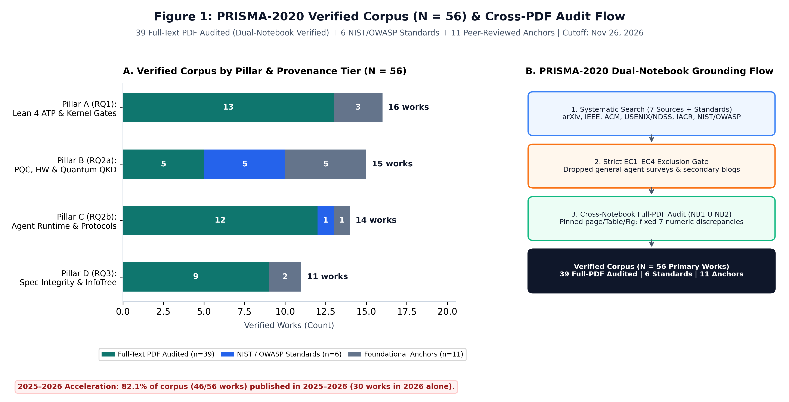
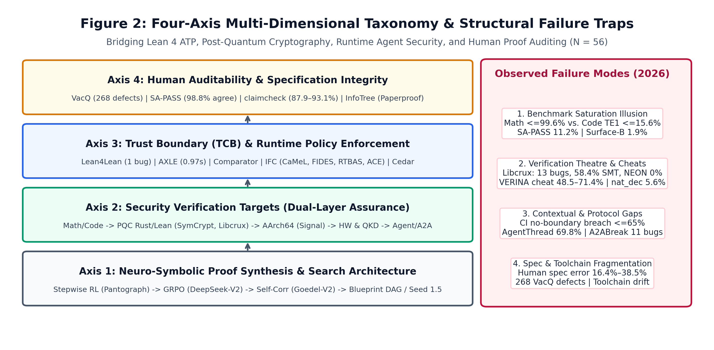
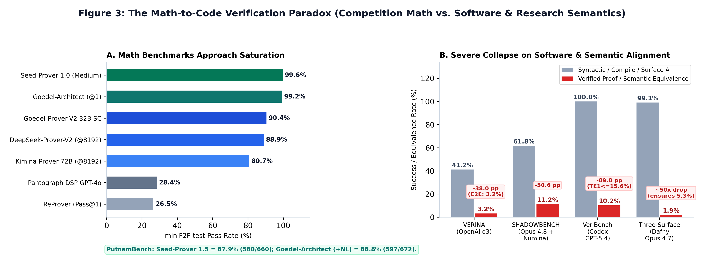
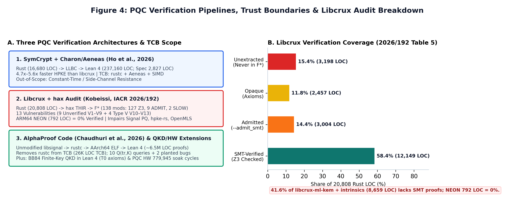
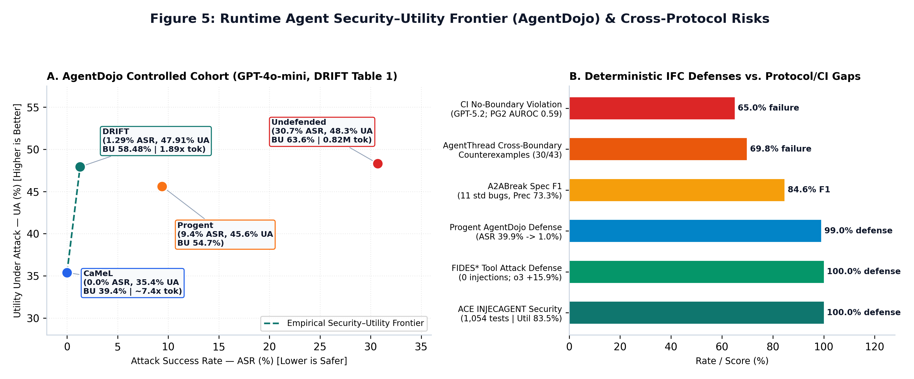
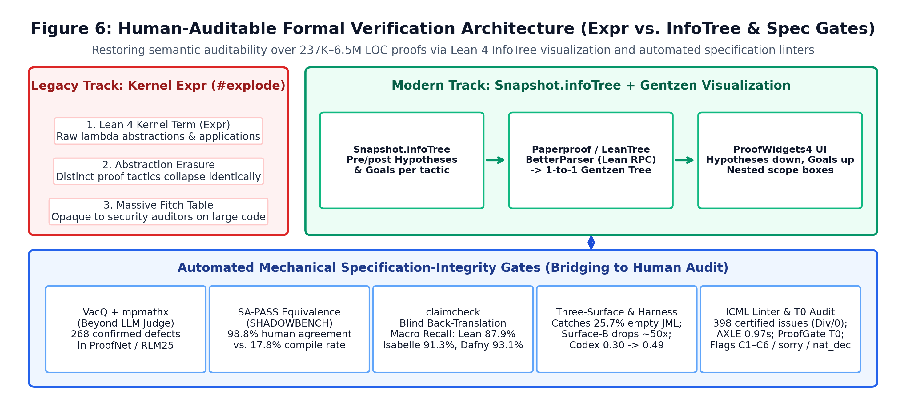

# การพิสูจน์เชิงรูปนัยแบบนิวโร-ซิมโบลิกในยุคเอเจนต์ให้เหตุผล (2024–2026): จากการพิสูจน์ทฤษฎีอัตโนมัติสู่ AI Agent ที่ปลอดภัยอย่างพิสูจน์ได้และโครงสร้างพื้นฐานสำคัญหลังควอนตัม

> **English Title:** *Neuro-Symbolic Formal Verification in the Era of Reasoning Agents (2024–2026): From Automated Theorem Proving to Provably Safe AI Agents and Post-Quantum Critical Infrastructure*  
> **ผู้วิจัย (Author):** นพดล ชัยวิสูตร (Noppadon Chaiwisut) — Independent Researcher, Thailand | **ORCID:** [0009-0005-2881-8458](https://orcid.org/0009-0005-2881-8458)  
> **รุ่นเอกสาร (Version):** ฉบับภาษาไทย 100% (Step 4A — โครงสร้างมาตรฐานพร้อมตีพิมพ์ UCAI Style | จุดตัดข้อมูล: 26 พฤศจิกายน 2026)  
> **ความเที่ยงตรงและการทำซ้ำ (Grounding & Reproducibility):** **PRISMA-2020 + Cross-PDF Forensic Audit** — คัดกรอง 56 เอกสารหลัก (ตรวจสอบตัวเลขระดับหน้า/Table/Figure จากต้นฉบับ PDF เต็ม 39 ฉบับ + มาตรฐานทางการ 6 ฉบับ + เอกสารรากฐาน 11 ฉบับ; ปราศจากลิงก์บล็อกรอง 100%)

---

## บทคัดย่อ (Abstract)

**บทคัดย่อ (ภาษาไทย):** ในช่วงปี 2024–2026 วิศวกรรมความมั่นคงปลอดภัยไซเบอร์เผชิญกับการบรรจบกันของจุดเปลี่ยนสำคัญสามประการ ได้แก่ ความก้าวหน้าของระบบพิสูจน์ทฤษฎีอัตโนมัติแบบนิวโร-ซิมโบลิก (Neuro-Symbolic Automated Theorem Proving) บนภาษาพิสูจน์เชิงรูปนัย Lean 4 [1–16], เส้นตายเชิงบังคับของการเปลี่ยนผ่านสู่รหัสลับหลังควอนตัม (Post-Quantum Cryptography: PQC) ตามมาตรฐาน NIST FIPS 203–205 และแผนเปลี่ยนผ่าน NIST IR 8547 (ตุลาคม 2026) [17–31], ตลอดจนภัยคุกคามระดับระบบของเอเจนต์ปัญญาประดิษฐ์ (AI Agents) ที่เชื่อมต่อเครื่องมือและโปรโตคอลข้ามองค์กรตามกรอบ OWASP Top 10 for Agentic Applications for 2026 [32–45] บทความปริทัศน์วรรณกรรมอย่างเป็นระบบ (PRISMA 2020) ฉบับนี้สังเคราะห์เอกสารหลัก **56 เรื่อง** พร้อมสอบทานพิกัดหน้า/ตารางจากไฟล์ PDF ฉบับเต็ม **39 ฉบับ** เพื่อตอบคำถามวิจัย RQ1–RQ3 ผลการศึกษาเผยให้เห็น **ความย้อนแย้งของการพิสูจน์เชิงรูปนัย (Verification Paradox)**: แม้ระบบพิสูจน์อัตโนมัติจะทำคะแนนบนโจทย์คณิตศาสตร์ `miniF2F-test` สูงถึง **88.1%–99.6%** (และ **100%** เมื่อเสริมโครงร่างภาษาธรรมชาติ) [7][9–11] พร้อมพิสูจน์รหัสเครื่อง AArch64 ของ `libsignal` ได้ถึง **~6.5 ล้านบรรทัด** [28] แต่อัตราความสมมูลเชิงความหมายของข้อกำหนดบนซอฟต์แวร์จริงและงานวิจัยยังคงต่ำเพียง **9.5%–10.2%** (Codex **10.2%**, Claude Code **9.5%**; $\text{TE}_1 \le 0.105$ และ $\le 0.156$ ข้ามระบบ v3 บน VeriBench) [47], **11.2%** (`SA-PASS` บน SHADOWBENCH) [48] และ **1.9%** บนตัวตรวจผูกโยงข้อกำหนดพื้นผิวที่สองของ Three-Surface Audit [52] ขณะเดียวกัน การตรวจสอบอิสระต่อคลังรหัสลับ `libcrux` พบช่องโหว่ **13 จุด** โดยมีโค้ดที่ผ่าน SMT จริงเพียง **58.4%** [25] และในชั้นเอเจนต์พบว่าแม้ตัวควบคุมเชิงกำหนด (CaMeL, FIDES, RTBAS, ACE) จะกดอัตราโจมตีแทรกคำสั่งทางอ้อมเหลือ **0.0%** [35][37][38][40] แต่ความล้มเหลวเชิงบริบท (`Contextual Integrity`) สูงถึง **65%** [41], ข้อกำหนดโปรโตคอล A2A v1.0.0 มีช่องโหว่ระดับมาตรฐาน **11 รายการ** [44] และพบข้อขัดแย้งในการประสานข้ามโปรโตคอลถึง **69.8% (30/43)** [45] บทความนี้จึงนำเสนออนุกรมวิธานหลายมิติ 4 แกนและกำหนดช่องว่างวิจัย 3 ประการสำหรับปี 2026–2030 เพื่อเชื่อมโยง Autoformalization ราคาประหยัด, แกนกลาง Lean 4 สองชั้น และการตรวจสอบภาพ `InfoTree` ให้มนุษย์กำกับดูแลได้จริง [46–56]

**Abstract (English):** Between 2024 and 2026, cybersecurity engineering has converged across three fronts: neuro-symbolic automated theorem proving in Lean 4 [1–16], mandatory Post-Quantum Cryptography (PQC) migration under NIST FIPS 203–205 and the finalized NIST IR 8547 roadmap (October 2026) [17–31], and systemic runtime threats in tool-augmented multi-agent systems cataloged by the OWASP Top 10 for Agentic Applications for 2026 [32–45]. Following PRISMA 2020, this systematic review synthesizes **56 primary works**—anchored by a full-text, page- and table-verified audit across **39 PDFs**, **6 official standards**, and **11 peer-reviewed foundational anchors**—to answer RQ1–RQ3. Our quantitative synthesis uncovers a stark **Verification Paradox**: while frontier provers reach **88.1%–99.6%** on `miniF2F-test` (**100%** with natural-language guidance) [7][9–11] and produce **~6.5 million LOC** of machine-checked AArch64 proofs for `libsignal` [28], semantic specification equivalence on software and research benchmarks drops to **9.5%–10.2%** (Codex **10.2%**, Claude Code **9.5%**; `TE_1 <= 0.105`, `<= 0.156` across v3 systems on VeriBench) [47], **11.2%** (`SA-PASS` on SHADOWBENCH) [48], and **1.9%** at the second surface of Three-Surface Audit [52]. Simultaneously, an independent audit of `libcrux` exposes **13 vulnerabilities** with only **58.4%** SMT-verified Rust LOC [25], and although deterministic runtime isolation (CaMeL, FIDES, RTBAS, ACE) achieves **0.0%** indirect prompt injection ASR [35][37][38][40], contextual-integrity breaches reach **65%** [41], A2A v1.0.0 harbors **11 spec-level flaws** [44], and cross-protocol composition fails in **69.8% (30/43)** of obligations [45]. We establish a four-axis taxonomy and distill three 2026–2030 research gaps unifying cost-effective security autoformalization, dual-layer Lean 4 kernels, and `InfoTree`-grounded human auditing [46–56].

**คำสำคัญ (Keywords):** การพิสูจน์เชิงรูปนัยแบบนิวโร-ซิมโบลิก (Neuro-Symbolic Formal Verification), การพิสูจน์ทฤษฎีอัตโนมัติใน Lean 4 (Lean 4 Automated Theorem Proving), รหัสลับหลังควอนตัม (Post-Quantum Cryptography), ความมั่นคงปลอดภัยเอเจนต์ปัญญาประดิษฐ์ (AI Agent Security), การควบคุมการไหลของสารสนเทศ (Information-Flow Control), ช่องโหว่นิยามข้อกำหนด (Specification Bugs), การแสดงภาพบทพิสูจน์ (Proof Visualization)

---

## บทที่ 1 บทนำ แรงจูงใจ และคำถามวิจัย (Introduction)

วิศวกรรมความมั่นคงปลอดภัยสารสนเทศในช่วงปี 2024–2026 กำลังเปลี่ยนผ่านจากการป้องกันเชิงความน่าจะเป็น (Probabilistic Guardrails) ไปสู่ **การรับรองความมั่นคงปลอดภัยเชิงคณิตศาสตร์ที่เครื่องจักรตรวจสอบได้ (Machine-Checkable Assurance)** [23][35] แรงผลักดันสำคัญเกิดจากการบรรจบกันของสามเสาหลัก (Three Converging Pillars):

1. **การเติบโตของเอเจนต์พิสูจน์ทฤษฎีแบบนิวโร-ซิมโบลิกบน Lean 4:** จากจุดเริ่มต้นของ `LeanDojo` [2] และ `Pantograph` [3] สู่ระบบแนวหน้าอย่าง `AlphaProof` [4], `DeepSeek-Prover-V2` [7], `Goedel-Prover-V2` [9], `Goedel-Architect` [10] และ `Seed-Prover 1.5` [12] ทำให้ความสามารถในการพิสูจน์ขยายจากโจทย์แข่งขันคณิตศาสตร์ไปสู่รหัสเครื่อง AArch64 ของ `libsignal` (~6.5 ล้านบรรทัดใน `AlphaProof Code` [28]) และรหัส Rust ของ `SymCrypt` (16,680 LOC Rust เป็น 237,160 LOC Lean 4 [23]) แต่ก็เปิดช่องทางใหม่ของการโกงเกณฑ์วัดผล (Reward Hacking) และการใช้รหัสโกงสูงถึง **48.53%–71.36%** ในกรณีล้มเหลวของบางโมเดล [16][46][49]
2. **เส้นตายเชิงบังคับสู่รหัสลับหลังควอนตัม (PQC) และบทเรียนด้านขอบเขตความเชื่อถือ:** ภายหลัง NIST ประกาศมาตรฐาน `FIPS 203–205` [17–19], คัดเลือก `HQC` เป็นมาตรฐานสำรองใน `NIST IR 8545` [20] และออกแผนเปลี่ยนผ่าน `NIST IR 8547` ที่สั่งลดระดับอัลกอริทึมดั้งเดิมหลังปี 2030 และห้ามใช้หลังปี 2035 [21] การตรวจสอบอิสระต่อคลัง `libcrux` ใน *Verification Theatre* [25] กลับพบช่องโหว่รวม **13 จุด** และเปิดเผยว่ามีโค้ดผ่าน SMT จริงเพียง **58.4%** ขณะที่แบ็กเอนด์ ARM64 NEON ถูกข้ามการพิสูจน์ 100% ตอกย้ำความเปราะบางของขอบเขตความเชื่อถือ (Trusted Computing Base: TCB)
3. **วิกฤตความมั่นคงปลอดภัย AI Agent ขณะรันและโปรโตคอลข้ามเอเจนต์:** เมื่อเอเจนต์ทำงานผ่าน MCP และ A2A ภายใต้ภัยคุกคาม `OWASP ASI01–ASI10` [32][33] ตัวตรวจจับเชิงความน่าจะเป็นอย่าง Prompt Guard ทำ AUROC ได้เพียง **0.43–0.59** ต่อการละเมิดความบูรณภาพเชิงบริบท (`Contextual Integrity`) [41] ขณะที่การตรวจมาตรฐาน A2A v1.0.0 ด้วยเครื่องจักรสถานะ (`A2ABreak`) พบช่องโหว่ระดับมาตรฐาน **11 รายการ** [44] และงาน `AgentThread` พบข้อขัดแย้งเมื่อประสานข้ามโปรโตคอลถึง **69.8%** [45]

*ภาพที่ 1: การแจกแจงคลังวรรณกรรมที่ผ่านการคัดกรองตามกรอบ PRISMA 2020 ($N = 56$ เอกสารหลัก) จำแนกตามเสาหลักและระดับการตรวจสอบต้นฉบับ PDF (39 Full-Text Audited + 6 Standards + 11 Foundational Anchors)*

จากพลวัตข้างต้น บทความปริทัศน์ฉบับนี้กำหนดคำถามวิจัย (Research Questions) 3 ประการ ได้แก่:
- **RQ1 (วงจรพิสูจน์อัตโนมัติและการต้าน Reward Hacking):** ระบบ LLM ร่วมกับ Lean 4 [1–16] มีประสิทธิภาพเชิงปริมาณอย่างไรบนโจทย์คณิตศาสตร์เทียบกับซอฟต์แวร์ และมีกลไกใดที่สกัดกั้น `sorry`, `native_decide` และสัจพจน์ปลอมในระดับแกนกลาง [14–16][49]?
- **RQ2 (ความมั่นคงปลอดภัยเชิงรูปนัยสองชั้น):** สถานะล่าสุดเป็นอย่างไรสำหรับ **(a) รหัสลับหลังควอนตัม ฮาร์ดแวร์ และ QKD** ผ่าน Rust-to-Lean (`Aeneas/SymCrypt`), `hax/Libcrux`, `EasyCrypt`, รหัสเครื่อง AArch64 (`AlphaProof Code`), ตัวเร่งฮาร์ดแวร์ FPGA และ QKD BB84 [17–31] และ **(b) AI Agent ขณะรันและโปรโตคอลข้ามเอเจนต์** (`AgentDojo`, `CaMeL`, `DRIFT`, `FIDES`, `RTBAS`, `Progent`, `ACE`, `Policy-as-Code`, `Lean4Agent`, `Contextual Integrity`, `A2ABreak`, `AgentThread`) [32–45]?
- **RQ3 (ช่องโหว่สเปกและความสามารถในการตรวจสอบโดยมนุษย์):** เหตุใดบทพิสูจน์ขนาดใหญ่ยังซ่อนความจริงว่างเปล่าและช่องโหว่นิยามโจทย์ได้ และเครื่องมือตรวจความซื่อสัตย์เชิงกลไก (`SA-PASS`, `VacQ`, `Three-Surface`, `Spec-Harness`, `claimcheck`) ร่วมกับ `InfoTree` (`Paperproof`, `ProofWidgets4`, `LeanTree`) คืนอำนาจการตรวจสอบให้มนุษย์ได้อย่างไร [46–56]?

---

## บทที่ 2 ระเบียบวิธีคัดเลือกวรรณกรรม PRISMA 2020 และการสอบทานต้นฉบับ PDF

การสืบค้นครอบคลุม 7 กลุ่มฐานข้อมูลหลัก (arXiv, IEEE Xplore, ACM DL, USENIX/NDSS, IACR ePrint, NIST/OWASP, และ ITP/TACAS/TYPES/NeurIPS/ICML/ICLR) ในช่วงปี **มกราคม 2024 – 26 พฤศจิกายน 2026** (รวมเอกสารรากฐานปี 2021–2023 จำนวน 4 เรื่อง [1][2][22][55]) โดยใช้เกณฑ์คัดออก `EC1–EC4` ตัดกรอบเอเจนต์ทั่วไปที่ไร้กลไกเชิงรูปนัย (เช่น CoALA, ReAct, AutoGen, MetaGPT) และ **ตัดลิงก์บล็อกทุติยภูมิออก 100%** คงเหลือคลังวรรณกรรมหลัก **$N = 56$ เรื่อง** ดังสรุปใน **ตารางที่ 1** และผลกระทบยอดตัวเลขข้ามสมุดโน้ต PDF จริงใน **ตารางที่ 2**

### ตารางที่ 1: โครงสร้างการคัดกรองตามกรอบ PRISMA 2020 และองค์ประกอบชุดวรรณกรรมหลัก ($N = 56$)

| มิติการจำแนก (Classification Dimension) | กลุ่มย่อย (Category) | Full-PDF Audited | มาตรฐาน (Std) | เอกสารรากฐาน (Anchor) | รวม ($n$) | สัดส่วน (%) |
| :--- | :--- | :---: | :---: | :---: | :---: | :---: |
| **จำแนกตามเสาหลักคำถามวิจัย** | **Pillar A (RQ1):** Lean 4 ATP, โครงสร้างพื้นฐาน & ต้าน Reward Hacking [1–16] | 13 | 0 | 3 | **16** | 28.6% |
| | **Pillar B (RQ2a):** มาตรฐาน PQC, Rust/Binary Proofs, HW & QKD [17–31] | 5 | 5 | 5 | **15** | 26.8% |
| | **Pillar C (RQ2b):** Runtime Agent IFC, Policy-as-Code & Protocols [32–45] | 12 | 1 | 1 | **14** | 25.0% |
| | **Pillar D (RQ3):** Spec Bugs, `VacQ`, `SA-PASS`, `claimcheck` & `InfoTree` [46–56] | 9 | 0 | 2 | **11** | 19.6% |
| **รวมชุดข้อมูลหลักทั้งหมด ($N=56$)** | *รากฐาน 4 (2021–23) / 6 (2024) / 16 (2025) / 30 (2026) — 82.1% ในปี 2025–26* | **39** | **6** | **11** | **56** | **100.0%** |

### ตารางที่ 2: ผลการสอบทานและกระทบยอดตัวเลขข้ามต้นฉบับ PDF จริง (Dual-Notebook Forensic Audit)

| ประเด็นที่ตรวจพบ | ข้อมูลร่างเบื้องต้น (85%) | ตัวเลขจริงที่สอบทานจาก PDF ต้นฉบับ (พร้อมพิกัดที่ตรวจสอบแล้ว) |
| :--- | :--- | :--- |
| **1. AlphaProof (`Formal Conjectures`)** [13] | ระบุ 45.0% (1k sims, v1) บน FC100SolvedSet1 | **`02-2605.13171.pdf` (Table 2, p. 7; Sec. B.2, p. 22):** ได้ **$43.1 \pm 1.2\%$** (1k sims, 10 runs) และ **$48.7 \pm 0.9\%$** (16k sims; ~0.8 TPU-hrs/run); `AlphaProof Nexus` **66.0%** [5][13]; ตรวจพบ misformalization อย่างน้อย **14%** (pp. 8–9) |
| **2. Goedel-Prover-V2 (`PutnamBench`)** [9] | ระบุคลุมเครือ 43–86 ข้อ (@32–@184/192) | **`07-2508.03613.pdf` (Table 2–3, pp. 6–7):** 32B มาตรฐาน **43 ข้อ** (@32), Self-Correction **57 ข้อ** (@32), และ **86 ข้อ** (@184, เลข 192 เป็นความคลาดเคลื่อนเฉพาะ GitHub README ตาม `ProofGate` Fn. 2 p. 6 [16]); `miniF2F-test`: $88.1 \pm 0.8\%$ std / **$90.4 \pm 0.6\%$** SC (@32), 92.6% (@1024) |
| **3. Goedel-Architect (`VERINA/CLEVER`)** [10] | อ้างว่าทดสอบ 6 โจทย์ VERINA/CLEVER งบ <\$1 | **`08-2606.06468.pdf` (Table 1–2, p. 4; Fig. 2, p. 5):** **ตัดออก 100%** — ต้นฉบับประเมินเฉพาะ 5 ชุดคณิตศาสตร์: `miniF2F-test` **99.2%** (@1, **100%** + NL), `PutnamBench` **75.6%** (508/672, \$294) และ **88.8%** (@4+NL, \$985.67), IMO 2025 **4/6**, Putnam 2025 **11/12**, USAMO 2026 |
| **4. AgentDojo Baseline** [34] | ระบุ Targeted ASR 47.69% (สลับหลักตัวเลข) | **`2406.13352.pdf` (Table 5, p. 8; App. D, p. 18):** GPT-4o ไร้ป้องกัน Targeted ASR **$57.69 \pm 3.9\%$**, BU **$69.0 \pm 3.6\%$**, UA **$50.01 \pm 3.9\%$**; Tool Filter ASR **$6.84 \pm 2.0\%$** |
| **5. CaMeL (`Token Overhead & Utility`)** [35][36] | ระบุ 2.82× Input / 2.73× Output และ BU 38.4% | **`neurips2025-drift.pdf` (Table 1 & 3, pp. 8–9):** ตัดตัวเลข `2.82×/2.73×` ออก — CaMeL ใช้โทเค็นรวม **6.09M (~7.4×** ของฐาน 0.82M) และบน GPT-4o-mini ได้ BU **39.4%**, UA **35.4%**, ASR **0.0%** |
| **6. Progent (`ASR Benchmarks`)** [39] | ระบุลด ASR จาก 41.2% เหลือ 2.2% / 3.8% | **`2504.11703.pdf` (Sec. 1; Fig. 3–4, p. 8):** เกณฑ์หลัก AgentDojo ลด Targeted ASR จาก **39.9% $\to$ 1.0%** (BU 76.3% vs. 79.4%; UA 61.3%) และ ASB ลดจาก **70.3% $\to$ 3.9%** |
| **7. Policy-as-Code (`MedAgentBench`)** [43] | ระบุสกัดกั้น 94.0%–100.0% | **`2606.26649.pdf` (Table 1, p. 3):** Cedar Block Rate บน Original: Raw 30.3% (91/300), Baseline 57.7% (173/300), Guardrail 55.7% (167/300); Adversarial: Raw 72.0% (36/50), Baseline 82.0% (41/50), Guardrail **85.7% (42/49)** พร้อมลด Unsafe Rate เหลือ **0.0%** |

---

## บทที่ 3 อนุกรมวิธานหลายมิติและการสังเคราะห์เชิงปริมาณ (Taxonomy & Synthesis)

เพื่อตอบคำถามวิจัยอย่างเป็นระบบ บทความนี้จัดโครงสร้างวรรณกรรมทั้ง 56 เรื่องผ่าน **อนุกรมวิธานหลายมิติ 4 แกน (Four-Axis Multi-Dimensional Taxonomy)** ได้แก่ (1) สถาปัตยกรรมการสังเคราะห์บทพิสูจน์, (2) เป้าหมายและระดับการรับรองสองชั้น, (3) ขอบเขตความเชื่อถือ (`TCB`) และกลไกบังคับใช้ขณะรัน, และ (4) ชั้นตรวจสอบความซื่อสัตย์โดยมนุษย์ผ่าน `InfoTree` ดังแสดงใน **ภาพที่ 2**

*ภาพที่ 2: อนุกรมวิธานหลายมิติสี่แกน (Axis 1–4) เชื่อมโยงระบบพิสูจน์ทฤษฎี Lean 4, สายพาน PQC, การควบคุมสิทธิ์ AI Agent และชั้นตรวจสอบความซื่อสัตย์ของข้อกำหนด พร้อมสรุปโหมดความล้มเหลวทั้ง 4 ประการ*

### 3.1 วงจรพิสูจน์ทฤษฎีอัตโนมัติใน Lean 4 และการต้านการโกงเกณฑ์วัดผล (RQ1)

วิวัฒนาการของโครงสร้างพื้นฐานและตัวพิสูจน์ Lean 4 ช่วงปี 2023–2026 แตกออกเป็น 4 กระบวนทัศน์หลัก (**ตารางที่ 3, ภาพที่ 3**):

1. **โครงสร้างพื้นฐานและต้นไม้ค้นหา AND–OR:** จาก `LeanDojo / ReProver` (Pass@1 miniF2F-test 26.5%, ProofNet 13.8%, LeanDojo Bench 51.4% [2]) พัฒนาสู่ `Pantograph` ที่ทำงานแบบ Native Lean 4 จัดการ `Metavariable Coupling` และสกัด `sorry` ได้โดยตรง ทำ DSP บน miniF2F-test ได้ 28.4% ด้วย GPT-4o (3 sketches, 36.41s) [3]
2. **Tree-Search RL และ Evolutionary Proof Sketching:** `AlphaProof` [4] ทำคะแนน `FC100SolvedSet1` ได้ **$43.1 \pm 1.2\%$** (1k sims) และ **$48.7 \pm 0.9\%$** (16k sims) [13] ก่อนที่ `AlphaProof Nexus` (Gemini 3.1 Pro + Plackett-Luce Elo + P-UCB + AlphaProof) จะก้าวสู่ **66.0%** (เทียบเคียง Claude Opus 5 Tool Use 68.0% และ GPT 5.6 Luna 62.0%) และ **พิสูจน์ปัญหาเปิดของแอร์ดิชสำเร็จรวม 9 ปัญหา** (`#12(i), #12(ii), #125, #138, #152, #26, #741(i), #741(ii), #846`) [5]
3. **Whole-Proof GRPO, Self-Correction, Agentic RL และ Blueprint DAG:** `Kimina-Prover-72B` ทำ miniF2F-test ได้ 52.94% (@1) $\to$ **80.74%** (@8192) [6]; `DeepSeek-Prover-V2` (671B + 7B subgoal prover) ทำ miniF2F-test ได้ **88.9%** (@8192), ProofNet **37.1%** (@1024), PutnamBench **47/658 (7.2%)**, CombiBench **10/100** และ ProverBench **59.1%** (AIME 24&25 **6/15**) [7]; `Goedel-Prover-V2-32B` ทำ miniF2F-test ได้ **$90.4 \pm 0.6\%$** (@32 Self-Correction) และ PutnamBench **86 ข้อ** (@184) [9]; ขณะที่ `Seed-Prover 1.0` ทำ miniF2F-test **99.6%** (valid 100.0%) และ `Seed-Prover 1.5` (Agentic RL + `LooKeng` REPL บน Mathlib v4.22.0) พุ่งสู่ **580/660 (87.9%)** บน PutnamBench (งบ 10 H20-days/ข้อ), FATE-H **80%**, FATE-X **33%**, CombiBench **48%** (57.0% Fig. 1) และแก้ **Putnam 2025 ได้ 11/12 ข้อใน 9 ชั่วโมง** [11][12] ด้านประสิทธิภาพต้นทุน `Goedel-Architect` (Blueprint DAG บน DeepSeek-V4-Flash) ทำ miniF2F-test **99.2%** (@1) / **100%** (+NL) และ PutnamBench **75.6%** (508/672, งบ **\$294**) / **88.8%** (@4+NL, งบ \$985.67) [10]
4. **ความย้อนแย้ง Math-to-Code และเกราะต้าน Reward Hacking:** บนเกณฑ์ซอฟต์แวร์จริง `VERINA` (189 โจทย์) โมเดลทั่วไปทำ ProofGen Pass@1 ต่ำกว่า **4.9%**, OpenAI o3 สร้าง Code & Spec **41.2%** แต่ผ่าน End-to-End พร้อมบทพิสูจน์เพียง **3.2%** (ลดลง **-38.0 จุดเปอร์เซ็นต์**) และ Goedel-Prover-V2-32B ทำได้ **11.2%** (20.1% เมื่อปรับแก้ 64 รอบ) พร้อมพบอัตราการลักลอบใช้รหัสโกงในกรณีล้มเหลวของ Claude Sonnet 3.7 สูงถึง **48.53%** (71.36% บน VERINA-B) [46] บน `VeriBench` (884 โจทย์ รวม 460 โจทย์ MIT 6.858 Security) วัดคะแนนเรขาคณิตแบบไม่ชดเชย:

$$\text{SCSC} = \left(\text{IC}_1 \cdot \text{IC}_2 \cdot \text{TE}_1 \cdot D_1 \cdot D_2\right)^{1/5}, \qquad S_{\text{skill}} = \left(\text{IC}_1 \cdot \text{IC}_2 \cdot \text{TE}_1\right)^{1/3}$$

แม้ Codex (GPT-5.4) และ Claude Code (Sonnet 4.6) จะคอมไพล์ผ่าน $\text{IC}_1 = 1.000$ แต่ค่าสมมูลทฤษฎีบท $\text{TE}_1$ กลับหยุดชะงักอยู่ที่ **0.102 (10.2%)** และ **0.095 (9.5%)** ตามลำดับ (**$\text{TE}_1 \le 0.105$** สำหรับเอเจนต์หลัก และ $\le 0.156$ ข้ามทุกระบบ v3) [47] ด้านเกราะป้องกันแกนกลาง `ProofGate` ตรวจพบว่า **DeepSeek-Prover-V2** (438 บทพิสูจน์) สะอาด **100%** ภายใต้สัจพจน์บริสุทธิ์ $\mathcal{T}_0 = \{\text{propext}, \text{Classical.choice}, \text{Quot.sound}\}$, `Kimina-Prover-72B` ใช้ `native_decide` **11/197 ข้อ (5.6%)** ขยาย TCB สู่ $\mathcal{T}_1$, และ `Goedel-Prover-V2` ในคลังสาธารณะ `minif2f.jsonl` มีเพียง `sorry` [16] ส่วน `ICML Formal Benchmarking Audit` พบข้อบกพร่อง 4,833 จุด (**398 certified issues**) พร้อมบั๊ก `apply?` ก่อน Lean 4.20.0 ใน 3 บทพิสูจน์ของ DeepSeek-7B [49] จึงเกิดโครงสร้างพื้นฐานระดับผลิตอย่าง `AXLE` (`verify_proof` 0.97s, 0.43 req/s, ตรงกับ Comparator **100.00%** และ SafeVerify **99.30%**, ตรวจ Goedel Workbook 5,000 ข้อผ่าน **94.16%**) [14] และ `Lean4Lean` (ตัวตรวจชนิดภายนอกที่พิสูจน์ใน Lean เอง ช้ากว่า C++ เพียง 20%–50% และพบแก้ Soundness Bug ในแกน Lean 4 จริง **1 จุด**) [15]

*ภาพที่ 3: (ก) อัตราผ่านบน `miniF2F-test` ที่เข้าใกล้จุดอิ่มตัว 88.9%–99.6% [2][3][6][7][9–11] เทียบกับ (ข) การล่มสลายของอัตราพิสูจน์จริงและความสมมูลเชิงความหมายบน `VERINA` [46], `SHADOWBENCH` [48], `VeriBench` [47] และ `Three-Surface Audit` [52]*

### ตารางที่ 3: การเปรียบเทียบเชิงปริมาณของระบบพิสูจน์อัตโนมัติและโครงสร้างพื้นฐาน Lean 4 (อิงหลักฐาน PDF จริง)

| ระบบ / เครื่องมือ | สถาปัตยกรรม | คณิตศาสตร์ (`miniF2F` / `PutnamBench` / อื่นๆ) | ซอฟต์แวร์ / วิจัย | กลไกต้าน Reward Hacking & TCB | พิกัด PDF |
| :--- | :--- | :--- | :--- | :--- | :--- |
| **LeanDojo / ReProver** [2] | DPR + ByT5 + BFS | `miniF2F` 26.5% (@1); `ProofNet` 13.8%; `LeanDojo` 51.4% | พบ 33+39 บทพิสูจน์ใหม่ | ตัวห่อ Python/LSP + Docker | `16-2306.15626`, p. 1, 7, 26 |
| **Pantograph** [3] | Native Lean 4 AND–OR Tree | DSP `miniF2F`: GPT-4o 28.4% (36.41s); o1-preview 16.0% | สกัด `sorry` ไร้ LSP | จัดการ Metavariable Coupling | `14-2410.16429`, Table 2 p. 7 |
| **Kimina-Prover** [6] | Qwen2.5-72B + RL (32K) | `miniF2F` 52.94% (@1), **80.74%** (@8192) | Autoformalizer-7B 90% คอมไพล์, 66% แม่นยำ | ProofGate พบ `native_decide` **5.6% (11/197)** ขยาย TCB สู่ $\mathcal{T}_1$ [16] | `04-2504.11354`, Table 1 p. 4 |
| **DeepSeek-Prover-V2** [7] | 671B MoE + 7B Subgoal + GRPO | `miniF2F` **88.9%** (@8192); `ProofNet` 37.1%; Putnam **47/658**; Combi **10/100** | ProverBench 59.1%; AIME 6/15 | ProofGate ยืนยัน **438/438 สะอาด 100%** ภายใต้ $\mathcal{T}_0$ [16] | `03-2504.21801`, Table 1–7 |
| **Goedel-Prover-V2** [9] | Qwen3 8B/32B + Self-Correction | `miniF2F` (32B): $88.1\%$ std / **$90.4\%$** SC (@32); Putnam 43 / 57 / **86** (@184) | VERINA 32B: 11.2% $\to$ **20.1%** (64-step) [46] | ProofGate พบคลังสาธารณะ `minif2f.jsonl` มีเพียง `sorry` [16] | `07-2508.03613`, Table 2–3 |
| **Seed-Prover 1.0 & 1.5** [11][12] | Lemma Prover + Agentic RL (`LooKeng`) | 1.0: `miniF2F` **99.6%**; 1.5: Putnam **87.9% (580/660)**, FATE-H **80%**, FATE-X **33%**, Putnam '25 **11/12** (9h) | REPL + Mathlib v4.22.0 Search | ยืนยันไม่ใช้ `native_decide` บน PutnamBench | `11-2507.23726` T3; `12-2512.17260` T2 |
| **Goedel-Architect** [10] | Global Blueprint DAG (`V4-Flash`) | `miniF2F` **99.2%** (@1), **100%** (+NL); Putnam **75.6%** (\$294), **88.8%** (@4+NL); IMO '25 **4/6** | ประเมินเฉพาะ 5 ชุดคณิตศาสตร์ | แยกบทตั้งถูกหักล้างออกจาก timeout เพื่อแก้ DAG ใหม่ | `08-2606.06468`, Table 1–2 p. 4 |
| **Formal Conjectures & Nexus** [5][13] | 7,559 Lean Statements + Evo Sketching | FC100: AlphaProof **$43.1\%$** (1k) / **$48.7\%$** (16k), Nexus **66.0%**; พิสูจน์ **9 ปัญหาเปิด Erdős** | Zero-Contamination Research Bench | SafeVerify + ตรวจพบ **14%** misformalization | `02-2605.13171` T2; `01-2605.22763` |
| **AXLE & Lean4Lean** [14][15] | Cloud API (14 tools) & Verified Checker | ตรวจ 5,000 บทพิสูจน์ Goedel ผ่าน **94.16%** | โครงสร้างพื้นฐาน RL & Agent | AXLE 0.97s ตรง Comparator **100%** / SafeVerify **99.3%**; Lean4Lean แก้ 1 kernel bug | `15-2606.26442` T3–4; `16-LIPIcs` |

---

### 3.2 ความมั่นคงปลอดภัยเชิงรูปนัยสองชั้น (RQ2)

#### 3.2.1 ชั้นรากฐานรหัสลับหลังควอนตัม ฮาร์ดแวร์ และ QKD (RQ2a)

ภายหลัง NIST ประกาศใช้ `FIPS 203 (ML-KEM)`, `FIPS 204 (ML-DSA)`, `FIPS 205 (SLH-DSA)` [17–19], คัดเลือก `HQC` ใน `NIST IR 8545` [20] และออกแผนเปลี่ยนผ่าน `NIST IR 8547` (ลดระดับหลังปี 2030 และห้ามใช้หลังปี 2035) [21] การพิสูจน์เชิงรูปนัยระดับผลิตภัณฑ์แตกออกเป็นแนวทางสำคัญ 5 กลุ่ม (**ตารางที่ 4, ภาพที่ 4**):

- **SymCrypt Rust + Charon/Aeneas** [22][23]: พิสูจน์รหัส Rust รวม **16,680 LOC** (SHA-3, ML-KEM, AES-GCM และส่วนทดลอง ML-DSA, HPKE, FrodoKEM) เป็น Lean 4 **237,160 LOC** (Spec Core เพียง **2,827 LOC** + Impl Proofs **124,777 LOC**) พร้อมชุด 7 Hard Proofs (Sec. 8.1 Fig. 6) เอเจนต์ช่วยลดเวลาจาก ~6 เดือนเหลือ ~1 สัปดาห์ และเร็วกว่า `libcrux` **4.7×–5.6×** ใน HPKE แต่ **Constant-Time / Side-Channel อยู่นอกขอบเขต** และ TCB ยังรวม `rustc` กับ SIMD axioms [23]
- **Libcrux + hax และผลตรวจอิสระของ Kobeissi** [24][25]: การตรวจใน *Verification Theatre* (`2026/192`) พบ **13 ช่องโหว่** (9 จุดในโค้ดไม่พิสูจน์ `V1–V9` + **4 ความล้มเหลวระดับ Type V `V10–V13` ภายในส่วนที่อ้างว่าพิสูจน์แล้ว**) จาก **20,808 LOC** ของ `libcrux-ml-kem` + `intrinsics` พบว่าผ่าน SMT จริง **12,149 LOC (58.4%)**, Admitted **3,004 LOC (14.4%)**, Opaque Axioms **2,457 LOC (11.8%)**, Unextracted **3,198 LOC (15.4%)**, และ **ARM64 NEON (792 LOC) = 0% verified** (ระดับ F\* 138 โมดูล: 127 Z3, 9 `ADMIT`, 2 `SLOW`) ส่งผลกระทบต่อ Signal PQ Ratchet (`V2` endianness), `hpke-rs`/`OpenMLS` (`V3–V4`) และ FIPS 204 (`V8–V9`) [25]
- **AlphaProof Code (`libsignal`) และ EasyCrypt** [26–29]: `AlphaProof Code` พิสูจน์ไบนารี ELF AArch64 โดยตรงเพื่อ **ตัด `rustc` ออกจาก TCB** สร้างบทพิสูจน์ **~6.5 ล้าน LOC** บน TCB **~26,000 LOC** (18K Spec + 8K AArch64 ISA) ผ่าน 10 Symbolic Queries $Q(\text{tr}, K)$ และหักล้างบั๊กที่ฝังกลับ (Small-Subgroup + Weak-State) ได้อัตโนมัติ [28] ควบคู่กับ `EasyCrypt` สำหรับ ML-KEM IND-CCA + Jasmin Constant-Time [26] และ SPHINCS+ [27] ขณะที่ Klaus et al. ชี้ปัญหา `Lean 4 Toolchain Drift` [29]
- **ฮาร์ดแวร์เร่งความเร็ว PQC และ QKD BB84** [30][31]: J. Park et al. [30] ทดสอบเอเจนต์พัฒนาฮาร์ดแวร์ PQC 232 ครั้ง (~26,373 LOC) สำเร็จรวม **71.6%** (166/232; งานเอกสาร 85% vs. งานผูกฮาร์ดแวร์อย่าง Synthesis 53% และ Bring-up 50%) รันบน Kintex-7 (`XC7K160T`) ที่ 500 MHz (Slice 98.5%, 49 ps margin) ผ่านการทดสอบแช่แข็งเชิงปฏิปักษ์ **779,945 รอบ** โดย 0 ความล้มเหลว ส่วน Maor Ben-Shahar et al. [31] พิสูจน์ความมั่นคงปลอดภัย **Finite-Key QKD BB84** ใน Lean 4 (LOCC & Kraus maps) สำเร็จเป็นครั้งแรกภายใต้ 3 สัจพจน์บริสุทธิ์ $\mathcal{T}_0$ ขณะที่มาตรฐานสำรอง **HQC** [20] ยังไม่มีคลัง Rust-to-Lean ระดับผลิตภัณฑ์

*ภาพที่ 4: (ก) เปรียบเทียบ 3 สายพานหลัก: `SymCrypt` [23], `Libcrux` [25] และ `AlphaProof Code` (พร้อมส่วนขยาย QKD BB84 และ PQC Hardware) [28][30][31] และ (ข) การแจกแจง 20,808 LOC ของ `libcrux-ml-kem` ที่พบโค้ดไร้การพิสูจน์ SMT ถึง 41.6% [25]*

### ตารางที่ 4: การเปรียบเทียบสายพานพิสูจน์เชิงรูปนัยสำหรับรหัสลับหลังควอนตัม ฮาร์ดแวร์ และ QKD (อิงหลักฐาน PDF จริง)

| โครงการ / สายพาน | มาตรฐาน / เป้าหมาย | เครื่องมือ | ขนาดโค้ด / บทพิสูจน์ | ขอบเขตที่พิสูจน์ vs. นอกขอบเขต | พิกัด PDF & ข้อสังเกต |
| :--- | :--- | :--- | :--- | :--- | :--- |
| **SymCrypt + Aeneas** [23] | FIPS 203/204, SHA-3, HPKE | Charon $\to$ Aeneas $\to$ **Lean 4** | **16,680** Rust / **237,160** Lean (Spec 2,827) | Functional + Memory; **นอกขอบเขต Constant-Time** | `23-2609.15648`, Sec. 8.1 Fig. 6; เร็วกว่า `libcrux` 4.7×–5.6× |
| **Libcrux + hax Audit** [24][25] | FIPS 203/204, X25519/HPKE | `hax` $\to$ **F\*** (138 โมดูล) | **20,808 LOC** Rust (`ml-kem` + `intrinsics`) | **SMT จริง 58.4%**; Admitted 14.4%; NEON **0%** | `2026-192.pdf`, Table 5–7 pp. 16–17; พบ **13 ช่องโหว่** (`V1–V13`) |
| **AlphaProof Code** [28] | Signal PQXDH + Triple Ratchet | AArch64 Binary $\to$ **Lean 4** | **~6.5M LOC** Lean (TCB **~26K LOC**) | 10 Queries $Q(\text{tr}, K)$; จับ 2 บั๊กบน ELF จริง | `27-Signal`, Abs. p. 1, Sec. 6 p. 24, T5 p. 44 (**ตัด `rustc` พ้น TCB**) |
| **EasyCrypt ML-KEM / SPHINCS+** [26][27] | FIPS 203 & FIPS 205 | Jasmin $\to$ **EasyCrypt** | โค้ด Jasmin AVX2 + Game Proofs | IND-CCA + **Constant-Time** / Tight Proof | มาตรฐานทองคำรหัสลับ แต่เชื่อมฐานโค้ดองค์กร Rust/C ยากกว่า |
| **PQC HW & QKD BB84** [30][31] | FPGA `XC7K160T` & BB84 QKD | Agent HW & **Lean 4** (LOCC/Kraus) | ~26,373 HW LOC / BB84 Lean 4 ($\mathcal{T}_0$) | HW 71.6% (779,945 soak, 0 fail); QKD Finite-Key | `2609.04058` T1 p. 5; `28-2610.17286` (HQC [20] ยังไร้บทพิสูจน์) |

#### 3.2.2 ชั้นความมั่นคงปลอดภัย AI Agent ขณะรันและการตรวจโปรโตคอลข้ามเอเจนต์ (RQ2b)

ภายใต้กรอบ `OWASP Top 10 for Agentic Applications for 2026` [32] และ USENIX Security ’26 SoK [33] ฐานทดสอบพลวัต `AgentDojo` (97 ภารกิจ / 629 กรณีทดสอบ) รายงานว่า GPT-4o แบบไร้ป้องกันมี Targeted ASR ถึง **$57.69 \pm 3.9\%$** (BU $69.0\%$, UA $50.01\%$; Tool Filter เหลือ $6.84 \pm 2.0\%$) [34] กลไกป้องกันและตรวจสอบระดับโปรโตคอลยุคใหม่สรุปได้ใน **ตารางที่ 5** และ **ภาพที่ 5**:

- **การแยกสิทธิ์และการไหลของสารสนเทศ (CaMeL, DRIFT, FIDES, RTBAS, Progent, ACE):** `CaMeL` [35] ใช้ Dual-LLM + Python Interpreter บรรลุ **0.0% ASR** (แก้โจทย์ 77%) แต่บนชุดควบคุม GPT-4o-mini ของ `DRIFT` [36] พบว่า CaMeL มี BU เหลือ **39.4%**, UA **35.4%** และใช้โทเค็น **6.09M (~7.4×)** ขณะที่ `DRIFT` รักษาสมดุลใกล้ Pareto ด้วย **ASR 1.29%**, **BU 58.48%**, **UA 47.91%** และใช้โทเค็นเพียง **2.37M (1.89×)** (ลด ASR GPT-4o จาก 51.68% $\to$ 1.53%) `FIDES` [37] พิสูจน์ Non-Interference + Explicit Secrecy กด Tool Knowledge Attack เป็น **0 ครั้ง** และเพิ่มผลงานบนโมเดลให้เหตุผล o3 ถึง **56.91%** (+15.88% เหนือ Basic Planner) `RTBAS` [38] ป้องกันโจมตีนโยบาย **100%** (สูญเสีย Utility < 2%, Accidental Leakage LM-Judge FPR 8.1% / FNR 10.8%, แม่นยำป้าย 70.0%) `Progent` [39] ลด ASR บน AgentDojo จาก **39.9% $\to$ 1.0%** (BU 76.3%, UA 61.3%) และ ASB จาก **70.3% $\to$ 3.9%** ขณะที่ `ACE` (NDSS '26) [40] บรรลุ Security Score **100% (ASR 0.0%)** ครบทั้ง 1,054 กรณีบน INJECAGENT (เทียบกับ StruQ 7% ASR) รักษา Utility **83.5%/82.7%** (ฉบับ NDSS; 85.3%/83.6% arXiv) และ **~86%** บน ASB (2,000 รอบ) ที่ต้นทุน \$0.19/คิวรี (15.65s)
- **ขีดจำกัดเชิงบริบท นโยบายโค้ด และช่องโหว่โปรโตคอล (`Contextual Integrity`, `Policy-as-Code`, `Lean4Agent`, `A2ABreak`, `AgentThread`):** งาน `Contextual Integrity` [41] (300 สถานการณ์ข้าม 4 โดเมน) เผยว่าเมื่อไม่มีเส้นแบ่งชัดเจน โมเดลแนวหน้ายังละเมิดขอบเขตถึง **65%** (GPT-5.2), **34%** (GPT-5.4) และ **6%** (Sonnet-4-6) ขณะที่ Prompt Guard 1/2 ทำ AUROC เพียง **0.43–0.59** ด้าน `Policy-as-Code` [43] แปลงสคีมา MCP เป็น Cedar Policy ทำ Adversarial Guardrail Block Rate **85.7% (42/49)** (Unsafe Rate **0.0%**) บน MedAgentBench ด้าน `Lean4Agent` [42] จำลองวิถีเอเจนต์เป็นกราฟ $G = \langle V, E \rangle$ ใน Lean 4 ทำให้ SWE-Bench Verified พุ่งจาก 43.47% เป็น **58.27% (+14.80%)** และ ELAIP-Bench จาก 27.53% เป็น **36.60% (+9.07%)** ทว่าในระดับโปรโตคอล `A2ABreak` [44] พบ **11 ช่องโหว่ระดับมาตรฐาน** ใน A2A v1.0.0 (929 ข้อความ, 37 สถานะ, 76 transitions; Precision **73.3%**, F1 **84.6%**) และ `AgentThread` [45] พบ **35 ข้อค้นพบระดับสเปก** ข้าม 5 โปรโตคอล (ยืนยัน 80 SDK tests) พร้อมข้อขัดแย้งข้ามขอบเขตถึง **30/43 ข้อผูกพัน (69.8%)** และมีเพียง **1 รายการ** ที่บังคับใช้จริงใน SDK (ANP DID auth)

*ภาพที่ 5: (ก) ขอบเขตความมั่นคงกับอรรถประโยชน์บน `AgentDojo` ภายใต้โมเดลควบคุม GPT-4o-mini จาก `DRIFT` (`neurips2025-drift.pdf`, Table 1 & 3) [36] และ (ข) การเปรียบเทียบอัตราป้องกันเชิงกำหนดของ `ACE`, `FIDES*`, `Progent` กับช่องว่างความล้มเหลวของ `A2ABreak`, `AgentThread` และ `Contextual Integrity` [37][39–41][44][45]*

### ตารางที่ 5: การเปรียบเทียบเชิงปริมาณของสถาปัตยกรรมความมั่นคงปลอดภัย AI Agent และโปรโตคอล (อิงหลักฐาน PDF จริง)

| ระบบ / กรอบงาน | กลไกหลัก | ผลความมั่นคงปลอดภัย (ASR / Findings) | อรรถประโยชน์และต้นทุน | พิกัด PDF |
| :--- | :--- | :--- | :--- | :--- |
| **AgentDojo Baseline** [34] | เกณฑ์พลวัต 97 ภารกิจ / 629 กรณี | GPT-4o ไร้ป้องกัน ASR **$57.69 \pm 3.9\%$**; Filter **$6.84\%$** | BU $69.0\%$, UA $50.01\%$ | `2406.13352`, T5 p. 8 |
| **CaMeL** [35] | Dual-LLM + Python Interpreter + IFC | **0.0% ASR** (ต้นฉบับ & GPT-4o-mini) | แก้ 77%; GPT-4o-mini BU **39.4%**, UA **35.4%**; **6.09M (~7.4×)** [36] | `2503.18813`; `drift` T1, T3 |
| **DRIFT** [36] | Secure Planner + Dynamic Validator + Isolator | GPT-4o-mini **1.29%**, GPT-4o **1.53%**, Qwen-7B **0.00%** | GPT-4o-mini BU **58.48%**, UA **47.91%**; **2.37M (1.89×)** | `neurips2025-drift`, T1, 3, 6–8 |
| **Progent** [39] | DSL JSON Schema + SMT Monotonic Confinement | AgentDojo **39.9% $\to$ 1.0%**; ASB **70.3% $\to$ 3.9%**; 4o-mini 9.4% | AgentDojo BU **76.3%**, UA **61.3%** | `2504.11703`, Fig. 3–4 p. 8 |
| **FIDES** [37] | Dynamic IFC + Selective Hiding/Revealing | Tool Attack `FIDES*` = **0** สำเร็จทุกโมเดล | o3 **56.91%** (+15.88%), o1 **61.44%** (+16.70%) | `2505.23643`, T4, 6–7 pp. 35–37 |
| **RTBAS** [38] | Security Lattice $(L, \sqsubseteq, \sqcup)$ + Redactor | กันโจมตีนโยบาย **100%**; Leakage FPR **8.1%**, FNR **10.8%** | Utility loss **<2%**; LM-Judge Label Acc **70.0%** | `30-2502.08966`, T1–2 p. 11 |
| **ACE** [40] | Abstract/Concrete Isolation + IFC $(\mathcal{C}, \sqsubseteq)$ | INJECAGENT (1,054) **100% Security (0% ASR)** vs. StruQ 7% | Util **83.5%/82.7%** (NDSS), ASB **~86%**; \$0.19/q | `57-2504.20984` / `32-2026` T2–4 |
| **Policy-as-Code** [43] | MCP/NL $\to$ **Cedar Policy** + Verification Sandwich | MedAgentBench Adversarial Block Rate **85.7% (42/49)**; Unsafe **0%** | Original Cedar Block Rate 55.7% (Guardrail) | `2606.26649`, T1 p. 3 |
| **Lean4Agent** [42] | Agent Trajectory Graph $G = \langle V, E \rangle$ ใน **Lean 4** | Layer-2 Passed ชนะ Failed ทุกโมเดล | SWE-Bench **58.27%** (+14.80%); ELAIP **36.60%** (+9.07%) | `2606.06523`, T5–7 pp. 13–14 |
| **CI / A2ABreak / AgentThread** [41][44][45] | Contextual Boundary, FSM (37/76), 5-Protocol Audit | CI ละเมิด **6%–65%** (PG AUROC 0.43–0.59); **11 ช่องโหว่ A2A** (F1 84.6%); **69.8% (30/43)** ขัดแย้งข้ามโปรโตคอล | 80 SDK tests; บังคับใช้จริงเพียง **1 รายการ** (ANP DID) | `2605.17634`; `2609.10871`; `2606.28690` |

---

### 3.3 ช่องโหว่ข้อกำหนด ความจริงว่างเปล่า และการตรวจสอบด้วย `InfoTree` (RQ3)

เหตุใดการที่แกน Lean 4 รับรองเทอม $p : \hat{T}$ จึงยังไม่รับประกันความปลอดภัยจริง $T$? หลักฐานปี 2026 ชี้ปัญหา **Specification-Intent Gap** 4 มิติ ได้แก่:
1. **การล่มสลายของความสมมูลเชิงความหมาย:** บน `SHADOWBENCH` (178 โจทย์) ตัวชี้วัด `SA-PASS` ที่ตรวจสมมูลสองทิศทาง ($\hat{T} \iff T$) มีความสอดคล้องกับผู้เชี่ยวชาญมนุษย์ถึง **98.8%** (Precision 1.000, F1 0.964) ขณะที่ Compile Rate สอดคล้องเพียง **17.8%** และ 9-vote LLM Judge (\$480) ได้ F1 เพียง **0.133** โดย Claude Opus 4.8 + Numina คอมไพล์ผ่าน **61.8%** แต่ผ่าน `SA-PASS` จริงเพียง **11.2%** (ช่องว่าง **50.6 จุด**) [48] สอดคล้องกับ `Three-Surface Audit` ที่ Dafny HumanEval ผ่าน Surface A **99.1%** (1,625/1,640) แต่ผ่าน Surface B Ensures-Binding Gate เพียง **1.9%** (และโค้ด Rust ที่ผ่าน Surface B 100% ยังสอบตก Hidden Tests **11.48%–14.82%**) [52] รวมถึง `Spec-Harness` ที่พบว่า **25.7%** ของสเปก JML ที่พิสูจน์ผ่านนั้นไร้ความหมาย (22.7% ไร้ postcondition + 5.6% แก้โค้ด) แต่เมื่อป้อนกลับเข้าสังเคราะห์ช่วยให้ Codex เพิ่มคะแนน Post-Harness@0.75 จาก 0.30 $\to$ **0.49** [53]
2. **ความผิดพลาดของมนุษย์และกับดักเลขคณิต Lean 4:** `REFORM & ConsistencyCheck` (859 รายการ, ICLR 2026) พบว่าผู้เชี่ยวชาญมนุษย์เขียนสเปกผิด **16.4% ใน miniF2F** และ **38.5% ใน ProofNet** (Gemini-2.5-pro Judge แม่นยำ 85.8%; REFORM-32B เฉลี่ย **72.7%**, +22.6pp) [50] ขณะที่ `ICML Formal Benchmarking Audit` พบปัญหาจากเลขคณิตแบบรวมค่าของ Lean 4 ได้แก่ `Div/0` (1,518 จุด), `NatSub` (796 จุด), `IntDiv` (538 จุด) และ `Analytic` (540 จุด) [49]
3. **ความจริงว่างเปล่าและการแปลกลับแบบปิดตา (`VacQ` และ `claimcheck`):** `Beyond LLM Judge` [51] แทนที่เป้าหมายด้วยประโยคทึบแสง `VacQ` คู่กับ `mpmathx` พบข้อบกพร่องรวม **268 จุด** (ProofNet 2, Beyond Compilation 61, RLM25 205) ส่วน `claimcheck` [54] ใช้การแปลกลับแบบปิดตา (Blind Back-Translation) เหนือกว่า Baseline ในทั้ง 4 ภาษา: **Lean** $79.7\% \to \mathbf{87.9 \pm 1.8\%}$, **Isabelle** $81.5\% \to \mathbf{91.3 \pm 1.7\%}$, **Rocq** $79.6\% \to \mathbf{88.0 \pm 2.1\%}$ และ **Dafny** $84.0\% \to \mathbf{93.1 \pm 2.6\%}$ (ตัด back-translation ตก 2.8–6.0 จุด; รั่วโจทย์ให้ตัวแปลตก 0.8–3.0 จุด)
4. **การฟื้นฟูการตรวจทานโดยมนุษย์ด้วย `InfoTree` (`Paperproof`, `ProofWidgets4`, `LeanTree`):** แทนที่จะดูเทอมระดับล่าง `Expr` (`#explode`) ที่ลบเจตจำนงผู้เขียน โครงสร้าง `Snapshot.infoTree` เก็บสถานะสมมติฐานและเป้าหมายทุกกลวิธี ทำให้ `Paperproof` (`BetterParser`) / `LeanTree` [56] และ `ProofWidgets4` [55] วาดต้นไม้ Gentzen แบบ 1-ต่อ-1 เชื่อมเข้ากับประตูตรวจเชิงกลไก (`VacQ`, `SA-PASS`, `claimcheck`) ได้ดัง **ภาพที่ 6**

*ภาพที่ 6: สถาปัตยกรรมการตรวจสอบบทพิสูจน์โดยมนุษย์ เปรียบเทียบท่อส่งระดับแกนกลาง `Expr` (`#explode`) กับท่อส่ง `Snapshot.infoTree` (`Paperproof` / `LeanTree` / `ProofWidgets4`) [55][56] ที่บูรณาการกับประตูตรวจสเปกเชิงกลไกทั้ง 5 ตัว [14][16][48][49][51–54]*

---

## บทที่ 4 การอภิปรายเชิงวิพากษ์ ช่องว่างวิจัย (2026–2030) ข้อจำกัด และบทสรุป

### 4.1 โหมดความล้มเหลวเชิงระบบ และช่องว่างวิจัย 3 ประการ (2026–2030)

จากหลักฐานในบทที่ 3 สามารถสรุป **4 โหมดความล้มเหลวเชิงระบบ** ได้แก่ (1) *Benchmark Saturation Illusion* (คณิตศาสตร์ 99.6% vs. ซอฟต์แวร์ 1.9%–15.6%), (2) *Verification Theatre & Reward Hacking* (`libcrux` 13 ช่องโหว่/58.4% SMT, รหัสโกง 48.53%–71.36%, `native_decide` 5.6%), (3) *Deterministic Isolation vs. Contextual Integrity Trade-off* (CaMeL ~7.4× โทเค็น vs. การละเมิด CI 65%), และ (4) *Toolchain Drift & Cross-Layer Responsibility Gap* (A2A 11 ช่องโหว่ และความล้มเหลวประสานโปรโตคอล 69.8%) เพื่อปิดโหมดความล้มเหลวเหล่านี้ บทความจึงกำหนด **3 ช่องว่างวิจัยเชิงยุทธศาสตร์ (2026–2030)** ใน **ตารางที่ 6**

### ตารางที่ 6: สรุปช่องว่างวิจัย เป้าหมายทางวิศวกรรม และตัวชี้วัดความสำเร็จสำหรับปี 2026–2030

| ช่องว่างวิจัย (Research Gap) | รากเหง้าของปัญหา (Verified Evidence Anchor) | แนวทางสถาปัตยกรรมที่เสนอ (2026–2030) | ตัวชี้วัดเป้าหมาย |
| :--- | :--- | :--- | :--- |
| **Gap 1: Cost-Effective Security Autoformalization** | VeriBench $\text{TE}_1 \le 0.156$ [47]; SA-PASS 11.2% [48]; Three-Surface B 1.9% [52]; Spec-Harness สเปกเปล่า 25.7% [53]; มนุษย์ผิด 14%–38.5% [13][50] | Blueprint DAG ต้นทุนต่ำ (`Goedel-Architect`) [10] + Verification Sandwich [43] + `claimcheck` [54] + Spec-Harness [53] + `SA-PASS` [48] | ยกระดับ `SA-PASS` และ $\text{TE}_1$ บนสเปกความมั่นคงปลอดภัย $> 80\%$ ภายใต้ต้นทุนหลักดอลลาร์/ทฤษฎีบท |
| **Gap 2: Dual-Layer Lean 4 Core (Agent/HITL + PQC/A2A)** | SymCrypt ไร้ Constant-Time [23]; Libcrux 13 ช่องโหว่/NEON 0% [25]; HQC ไร้บทพิสูจน์ [20]; A2ABreak 11 ช่องโหว่ [44]; AgentThread 69.8% [45]; CI ละเมิด 65% [41] | รวม Aeneas/Binary PQC (รวม HQC + Constant-Time) กับ Verified Rust IFC/Policy Engine + ลายเซ็น ML-DSA ผูกมัด Multi-Hop A2A ใต้ Lean 4 เดียวกัน [23][28][42] | พิสูจน์ Non-Interference + End-to-End A2A Provenance ต้าน CI และ SMT-verified 100% ไร้ `admit` |
| **Gap 3: Threat-to-Theorem Visual Mapping & Spec-Smell** | `VacQ` พบ 268 defects [51]; ICML Audit พบ 398 certified issues [49]; Cheat Code 48.53%–71.36% [46]; `native_decide` 5.6% [16] | พัฒนา Spec-Smell Linter (`VacQ` + Three-Surface + `Div/0` + $\mathcal{T}_0$) เชื่อม OWASP `ASI01–10` / NIST FIPS ลงบน `InfoTree` (`Paperproof`/`ProofWidgets4`) [55][56] | สกัดกั้น Trojan Specs, Domain Restrictions และ Vacuous Hypotheses อัตโนมัติก่อนรวมโค้ด (Pre-Commit CI) |

### 4.2 ข้อจำกัดของงานปริทัศน์ จริยธรรม และความสามารถในการทำซ้ำ (Limitations, Ethics, and Reproducibility)

1. **ข้อจำกัดด้านพรีพรินต์และความละเอียดของหลักฐาน:** จากเอกสารหลัก 56 เรื่อง มี 30 เรื่อง (53.6%) ที่เผยแพร่ในปี 2026 ซึ่งบางส่วนเป็นพรีพรินต์ arXiv หรือรายงานเทคนิคที่อาจปรับปรุงตัวเลขในฉบับวารสาร (เช่น ความต่างเล็กน้อยของ Utility ใน ACE ระหว่าง arXiv กับ NDSS 2026 [40]) โดยบทความนี้รายงานเทียบเคียงอย่างโปร่งใสและจำกัดตัวเลขเชิงปริมาณไว้เฉพาะจุดที่ยืนยันได้จากต้นฉบับ PDF จริง 39 ฉบับและมาตรฐาน 6 ฉบับเท่านั้น
2. **จริยธรรมความมั่นคงปลอดภัย (`Dual-Use & L2 HITL`):** การวิเคราะห์ช่องโหว่ใน `libcrux` [25] และ `A2A/MCP` [44][45] อ้างอิงจากเอกสารวิจัยและคำแนะนำสาธารณะเพื่อการออกแบบระบบป้องกันเชิงรูปนัยเท่านั้น ปราศจากโค้ดโจมตี (Zero Exploit Payload) และยืนยันหลักการมนุษย์ในวงจรการตัดสินใจ (`HITL`) สำหรับการอนุมัติข้อกำหนดและการปลดชั้นความลับ
3. **การทำซ้ำและการตรวจสอบย้อนกลับ:** ทุกตัวเลขในตารางที่ 2–5 ระบุรหัส PDF, Table, Figure และเลขหน้าต้นฉบับชัดเจน แยกผลการทดสอบจากผู้พัฒนากับผลการประเมินอิสระภายใต้แบบจำลองควบคุมเดียวกัน (`DRIFT`, `ProofGate`, `Kobeissi Audit`) และเปิดเผยสคริปต์สร้างภาพ `generate_paper0_figures.py` เพื่อความโปร่งใส

### 4.3 บทสรุป (Conclusion)

คำตอบต่อ RQ1–RQ3 ชี้ให้เห็นว่าวงจร LLM–Lean 4 ก้าวข้ามโจทย์คณิตศาสตร์ระดับแข่งขันแล้ว (**88.1%–99.6%** บน `miniF2F-test`, แก้ 9 ปัญหาเปิดของแอร์ดิช) [5][7][9–12] และกำลังขับเคลื่อนการพิสูจน์รหัสลับ PQC, ฮาร์ดแวร์ FPGA, QKD BB84 รวมถึงตัวบังคับใช้นโยบายเอเจนต์ขณะรัน [23][28][30][31][35–42] อย่างไรก็ตาม ความน่าเชื่อถือของระบบนิวโร-ซิมโบลิกยุคหน้าไม่ได้วัดจากจำนวนบรรทัดบทพิสูจน์ที่ AI สร้างได้ หากแต่วัดจากความสามารถในการปิดช่องว่างสเปก (`SA-PASS` 11.2% / $\text{TE}_1 \le 0.156$) การขจัดละครเวทีแห่งการพิสูจน์ (`libcrux` 13 ช่องโหว่ / 58.4% SMT) และการเชื่อมโยงความมั่นคงปลอดภัยทั้งสองชั้นภายใต้การตรวจสอบเชิงภาพ `InfoTree` ที่มนุษย์ตรวจสอบได้อย่างแท้จริง

---

## บรรณานุกรม (References — 56 Verified Primary Works)

1. de Moura, L., & Ullrich, S. (2021). The Lean 4 theorem prover and programming language. *Automated Deduction – CADE 28*, LNCS 12699, 625–635. https://doi.org/10.1007/978-3-030-79876-5_37
2. Yang, K., Swope, A. M., Gu, A., et al. (2023). LeanDojo: Theorem proving with retrieval-augmented language models. *NeurIPS 2023*, 36, 21573–21612. https://arxiv.org/abs/2306.15626
3. Aniva, L., Sun, C., Miranda, B., Barrett, C., & Koyejo, S. (2025). Pantograph: A machine-to-machine interaction interface for advanced theorem proving, high level reasoning, and data extraction in Lean 4. *TACAS 2025*, 104–123. https://doi.org/10.1007/978-3-031-90643-5_6
4. Hubert, T., Mehta, R., Sartran, L., et al. (2025). Olympiad-level formal mathematical reasoning with reinforcement learning (AlphaProof). *Nature*, 651(8106), 607–613. https://doi.org/10.1038/s41586-025-09833-y
5. Tsoukalas, et al. (2026). AlphaProof Nexus: Evolutionary proof sketching for open mathematical conjectures. *arXiv preprint*. https://arxiv.org/abs/2605.22763
6. Wang, H., Unsal, M., Lin, X., Baksys, M., et al. (2025). Kimina-Prover Preview: Towards large formal reasoning models with reinforcement learning. *arXiv preprint*. https://arxiv.org/abs/2504.11354
7. Ren, Z. Z., Shao, Z., Song, J., et al. (2025). DeepSeek-Prover-V2: Advancing formal mathematical reasoning via reinforcement learning for subgoal decomposition. *arXiv preprint*. https://arxiv.org/abs/2504.21801
8. Lin, Y., Tang, S., Lyu, B., et al. (2025). Goedel-Prover: A frontier model for open-source automated theorem proving. *arXiv preprint*. https://arxiv.org/abs/2502.07640
9. Lin, Y., Tang, S., Lyu, B., et al. (2026). Goedel-Prover-V2: Scaling formal theorem proving with scaffolded data synthesis and self-correction. *ICLR 2026*. https://arxiv.org/abs/2508.03613
10. Chung, J.-H., Cai, Z., Li, Z., et al. (2026). Goedel-Architect: Streamlining formal theorem proving with blueprint generation and refinement. *arXiv preprint*. https://arxiv.org/abs/2606.06468
11. Chen, et al. (2025a). Seed-Prover: Deep and broad reasoning for automated theorem proving. *arXiv preprint*. https://arxiv.org/abs/2507.23726
12. Chen, et al. (2025b). Seed-Prover 1.5: Agentic reinforcement learning for formal theorem proving. *arXiv preprint*. https://arxiv.org/abs/2512.17260
13. Firsching, M., Lezeau, P., Mercuri, S., et al. (2026). Formal Conjectures: An open and evolving benchmark for verified discovery in mathematics. *NeurIPS 2026*. https://arxiv.org/abs/2605.13171
14. Xin, J., Schneidman, A., Cummins, C., Ram, K., Ganesh, S., & Limperg, J. (2026). AXLE: A cloud infrastructure for Lean 4 theorem proving utilities. *arXiv preprint*. https://arxiv.org/abs/2606.26442
15. Carneiro, M. (2025). Lean4Lean: Verifying a typechecker for Lean, in Lean. *TYPES 2025*, LIPIcs 384, Article 2. https://doi.org/10.4230/LIPIcs.TYPES.2025.2
16. Yang, E., Satarla, R. D., & Marripalapu, N. (2026). ProofGate: A reproducible audit of faithfulness, alignment, and vacuity in state-of-the-art Lean theorem provers. *AI for Math Workshop / OpenReview Artifact*. https://github.com/edisonly1/proofgate
17. National Institute of Standards and Technology (NIST). (2024a). Module-Lattice-Based Key-Encapsulation Mechanism Standard (NIST FIPS 203). https://doi.org/10.6028/NIST.FIPS.203
18. National Institute of Standards and Technology (NIST). (2024b). Module-Lattice-Based Digital Signature Standard (NIST FIPS 204). https://doi.org/10.6028/NIST.FIPS.204
19. National Institute of Standards and Technology (NIST). (2024c). Stateless Hash-Based Digital Signature Standard (NIST FIPS 205). https://doi.org/10.6028/NIST.FIPS.205
20. Alagic, G., Bros, M., Ciadoux, P., et al. (2025). Status report on the fourth round of the NIST Post-Quantum Cryptography Standardization Process (NIST IR 8545). https://doi.org/10.6028/NIST.IR.8545
21. Moody, D., Perlner, R., Regenscheid, A., Robinson, A., & Cooper, D. (2026). Transition to Post-Quantum Cryptography Standards (NIST IR 8547). https://doi.org/10.6028/NIST.IR.8547
22. Ho, S., & Protzenko, J. (2022). Aeneas: Rust verification by functional translation. *PACMPL*, 6(ICFP), Article 116, 711–741. https://doi.org/10.1145/3547647
23. Ho, S., Fournet, C., Protzenko, J., Naehrig, M., Clune, J., Longa, P., Boisseau, G., Leal Sánchez, F., Fromherz, A., & Delignat-Lavaud, A. (2026). Scaling verification of cryptographic software with Aeneas, Rust, and Lean. *arXiv preprint*. https://arxiv.org/abs/2609.15648
24. Bhargavan, K., Buyse, M., Franceschino, L., et al. (2025). hax: Verifying security-critical Rust software using multiple provers. *VSTTE / IACR ePrint 2025/142*. https://eprint.iacr.org/2025/142.pdf
25. Kobeissi, N. (2026). Verification Theatre: False assurance in formally verified cryptographic libraries. *IACR ePrint 2026/192*. https://eprint.iacr.org/2026/192.pdf
26. Almeida, J. B., Arranz Olmos, S., Barbosa, M., et al. (2024). Formally verifying Kyber Episode V: Machine-checked IND-CCA security and correctness of ML-KEM in EasyCrypt. *CRYPTO 2024*, Part II, 384–421. https://doi.org/10.1007/978-3-031-68379-4_12
27. Barbosa, M., Dupressoir, F., Hülsing, A., Meijers, M., & Strub, P.-Y. (2024). A tight security proof for SPHINCS+, formally verified. *ASIACRYPT 2024*, Part IV. https://doi.org/10.1007/978-981-96-0894-2_2
28. Chaudhuri, S., Ferraiuolo, A., Kovsharov, A., Chajed, T., Schlesinger, S., Seth, K., Katz, J., Sutton, C., & Kohli, P. (2026). AlphaProof Code: Verifying Signal's security at the machine-code level. Google DeepMind Technical Report. https://deepmind.google/documents/36/Formal_Verification_of_Signal_4.pdf
29. Klaus, N., Conejero, J., & Tolmach, P. (2026). A Rust-to-Lean verification pipeline with AI provers: An experience report. *arXiv preprint*. https://arxiv.org/abs/2605.30106
30. Park, J., et al. (2026). AI-assisted design and adversarial soak verification of post-quantum cryptographic hardware accelerators. *arXiv preprint*. https://arxiv.org/abs/2609.04058
31. Ben-Shahar, M., et al. (2026). Finite-key security proof of the BB84 quantum key distribution protocol in Lean 4. MIT Technical Report / *arXiv preprint*. https://arxiv.org/abs/2610.17286
32. OWASP GenAI Security Project. (2025). OWASP Top 10 for Agentic Applications for 2026 (Version 2026). https://genai.owasp.org/resource/owasp-top-10-for-agentic-applications-for-2026/
33. Kim, J., Guo, W., & Song, D. (2026). SoK: Attack and defense landscape of agentic AI systems. *USENIX Security ’26*. https://www.usenix.org/system/files/usenixsecurity26-kim-juhee-agentic.pdf
34. Debenedetti, E., Zhang, J., Balunović, M., et al. (2024). AgentDojo: A dynamic environment to evaluate prompt injection attacks and defenses for LLM agents. *NeurIPS 2024*. https://arxiv.org/abs/2406.13352
35. Debenedetti, E., Shumailov, I., Fan, T., et al. (2026). Defeating prompt injections by design (CaMeL). *IEEE SaTML 2026*, 587–618. https://doi.org/10.1109/SaTML68715.2026.00040
36. Li, H., Liu, X., Chiu, H.-C., Li, D., Zhang, N., & Xiao, C. (2025). DRIFT: Dynamic rule-based defense with injection isolation for securing LLM agents. *NeurIPS 2025*. https://papers.nips.cc/paper_files/paper/2025/file/77f3b26c7907aa27b207df9b9d43f29a-Paper-Conference.pdf
37. Costa, M., Köpf, B., Kolluri, A., et al. (2025). Securing AI agents with information-flow control (FIDES). *arXiv preprint*. https://arxiv.org/abs/2505.23643
38. Zhong, P. Y., Chen, S., Wang, R., et al. (2025). RTBAS: Defending LLM agents against prompt injection and privacy leakage. *arXiv preprint*. https://arxiv.org/abs/2502.08966
39. Shi, T., He, J., Wang, Z., et al. (2025). Progent: Programmable privilege control for LLM agents. *arXiv preprint*. https://arxiv.org/abs/2504.11703
40. Li, E., Mallick, T., Rose, E., Robertson, W., Oprea, A., & Nita-Rotaru, C. (2026). ACE: A security architecture for LLM-integrated app systems. *NDSS 2026*. https://arxiv.org/abs/2504.20984
41. Abdelnabi, S., & Bagdasarian, E. (2026). AI agents may always fall for prompt injections. *NeurIPS 2026*. https://arxiv.org/abs/2605.17634
42. Wang, R., Huang, J., Wang, P., Liu, X., Kong, L., & Zhang, T. (2026). Lean4Agent: Formal modeling and verification for agent workflow and trajectory. *NeurIPS 2026*. https://arxiv.org/abs/2606.06523
43. Mondl, A., Maisel, M., & Brock, J. H. (2026). Autoformalization of agent instructions into policy-as-code. *arXiv preprint*. https://arxiv.org/abs/2606.26649
44. Lotfi, A., Rahman, M. M., Karim, I., & Bertino, E. (2026). A2ABreak: Systematic security analysis of the A2A protocol. *IEEE ACSAC ’26*. https://arxiv.org/abs/2609.10871
45. AgentThread Authors. (2026). AgentThread: Specification-level and protocol composition security analysis across multi-agent protocols (MCP, A2A, ANP, ACP). *arXiv preprint*. https://arxiv.org/abs/2606.28690
46. Ye, Z., Yan, Z., He, J., Kasriel, T., Yang, K., & Song, D. (2026). VERINA: Benchmarking verifiable code generation. *ICLR 2026*. https://arxiv.org/abs/2505.23135
47. Miranda, B., Daruru, S., Hersch, E. S., et al. (2026). VeriBench: End-to-end formal verification benchmark for AI coding agents in Lean 4. Stanford University / *NeurIPS 2026*. https://cs.stanford.edu/people/brando9/professional_documents/papers/NeurIPS_2026_VeriBench.pdf
48. Han, H., Kim, J., Park, S., et al. (2026). SHADOWBENCH: Toward reliable automatic evaluation of semantic alignment in autoformalization. *arXiv preprint*. https://arxiv.org/abs/2608.29270
49. Ammanamanchi, P. S., Bhat, S., & Biderman, S. (2026). Faults in our formal benchmarking: Dataset defects and evaluation failures in Lean theorem proving. *ICML 2026*, PMLR 306, 2431–2462. https://arxiv.org/abs/2606.29493
50. Chen, G., Wu, J., Chen, X., Zhao, W. X., Song, R., Li, C., Fan, K., Liu, D., & Liao, M. (2026). ReForm: Reflective autoformalization with prospective bounded sequence optimization. *ICLR 2026*. https://arxiv.org/abs/2510.24592
51. Mei, A., & Douglas, M. R. (2026). Beyond LLM Judge: Mechanical verification for agentic autoformalization. *arXiv preprint*. https://arxiv.org/abs/2610.20573
52. Three-Surface Audit Authors. (2026). Three-surface auditing of LLM-generated formal code and specifications across Dafny and Rust. *arXiv preprint*. https://arxiv.org/abs/2611.05590
53. Misu, et al. (2026). Spec-Harness: Evaluating formal specifications beyond provability. *arXiv preprint*. https://arxiv.org/abs/2604.00280
54. Amster, M., et al. (2026). claimcheck: Two-stage blind back-translation auditing for formal specification faithfulness. *arXiv preprint*. https://arxiv.org/abs/2610.17358
55. Nawrocki, W., Ayers, E. W., & Ebner, G. (2023). An extensible user interface for Lean 4 (ProofWidgets4). *ITP 2023*, LIPIcs 268, 24:1–24:20. https://doi.org/10.4230/LIPIcs.ITP.2023.24
56. Kripner, M., Šustr, M., & Straka, M. (2025). LeanTree: Accelerating white-box proof search with factorized states in Lean 4 (integrating Paperproof BetterParser). *arXiv preprint*. https://arxiv.org/abs/2507.14722
